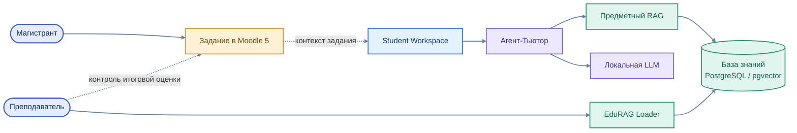
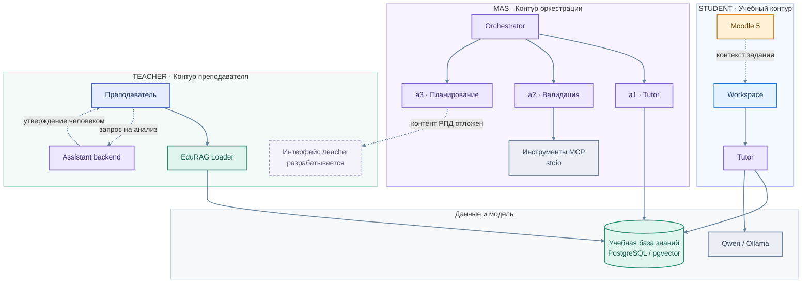

# EduTutor

### Интеллектуальная поддержка обучения анализу данных в магистратуре

**Образовательная платформа с локальной LLM, предметной базой знаний и многоагентной архитектурой**  
Московский городской педагогический университет · Институт цифрового образования

Проект развивается в рамках гранта **«LLM-ассистент для интеллектуальной поддержки обучения анализу данных в магистратуре»**, поддержанного Благотворительным фондом Владимира Потанина (2026).

**Цветная обзорная схема EduTutor**

Исходник схемы: [`edututor_overview.mmd`](assets/edututor_overview.mmd)

**Главная идея:** EduTutor сопровождает самостоятельную работу магистранта, помогая понимать задания, анализировать данные и разбирать ошибки, а преподавателю даёт инструменты подготовки учебного контента и предварительной обратной связи. **Окончательная оценка всегда остаётся за преподавателем.**

[Образовательный сценарий](education/01_student_path.md) · [Архитектура платформы](architecture/01_overview.md) · [Компоненты и агенты](architecture/02_agents.md) · [База знаний и RAG](architecture/03_rag.md)

---

## Для кого создаётся система

| Магистранту | Преподавателю | Образовательной программе |
|:--|:--|:--|
| Пояснения к заданиям, помощь с Python, SQL и анализом данных | Создание структуры дисциплины и подготовка материалов в EduRAG Loader | Предметно ориентированная база знаний |
| Подсказки по поиску ошибок и интерпретации результатов | Предварительные замечания по работе через backend Агента-Ассистента | Поддержка дисциплин и учебных активностей |
| Работа с контекстом дисциплины, а не с абстрактным чат-ботом | Контроль содержания и окончательного оценивания | Развитие цифровой образовательной среды |

**Цветная схема образовательного маршрута**

```mermaid
flowchart LR
    A(["Магистрант"]) --> B["Прочитать задание<br/>в Moodle"]
    B --> C["Уточнить подход<br/>с Tutor"]
    C --> D["Самостоятельно<br/>обработать данные"]
    D --> E["Проверить выводы<br/>и исправить ошибки"]
    E --> F["Сдать работу<br/>в Moodle"]
    F --> G(["Обратная связь<br/>преподавателя"])
    G -. "доработка" .-> D
    class A,G person;
    class B,F lms;
    class C agent;
    class D,E ui;

classDef person fill:#E5ECFD,stroke:#4164B9,color:#142C59,stroke-width:2px;
classDef lms fill:#FFF1D6,stroke:#D28A2B,color:#66440C,stroke-width:1.8px;
classDef ui fill:#E4F1FE,stroke:#2774C7,color:#153D6A,stroke-width:1.8px;
classDef agent fill:#EDE7FD,stroke:#7960C2,color:#3D2D73,stroke-width:1.8px;
classDef data fill:#E1F5EF,stroke:#268A6D,color:#155C4B,stroke-width:1.8px;
classDef infra fill:#EBEFF5,stroke:#6F8198,color:#35445A,stroke-width:1.8px;
classDef guard fill:#FFEBE8,stroke:#C76650,color:#7B3429,stroke-width:1.8px;
classDef future fill:#F4F2FB,stroke:#9D95BD,color:#55506E,stroke-width:1.5px,stroke-dasharray:5 4;
linkStyle default stroke:#63809B,stroke-width:1.8px;
```

Исходник схемы: [`learning_journey.mmd`](assets/learning_journey.mmd)

## Две дисциплины — единая методология

Проект ориентирован на направление **38.04.05 «Бизнес-информатика»**, профиль **«Бизнес-аналитика и большие данные»**.

| Дисциплина | Практический результат |
|---|---|
| **Python для анализа данных** | Подготовка, исследование, визуализация данных и интерпретация результатов |
| **Программные средства сбора, консолидации и аналитики данных** | Работа с API и веб-источниками, очистка, интеграция данных и управленческие выводы |

База знаний расширяется по мере публикации преподавателем материалов. Состав доступного контента зависит от конкретной дисциплины и этапа наполнения.

[Подробнее об учебных активностях](education/03_courses.md)

## Как устроен EduTutor

**Цветная архитектура трёх контуров**

Исходник схемы: [`platform_architecture.mmd`](assets/platform_architecture.mmd)

| Компонент | Назначение | Документация |
|---|---|---|
| **Student Workspace + Агент-Тьютор** | Диалог, пояснения, работа с кодом, RAG-контекст и локальная LLM | [EduTutor](services/edututor/README.md) |
| **Orchestrator + специализированные агенты** | Управляемая маршрутизация запросов, инструменты MCP и исследование верифицируемой оркестрации | [Агенты](architecture/02_agents.md) |
| **EduRAG Loader** | Каталогизация, подготовка и публикация учебных материалов для поиска | [EduRAG Loader](services/edurag_loader/README.md) |
| **Moodle `local_edututor`** | Связь учебного задания Moodle с контекстом обращения к помощнику | [Moodle](services/moodle_edututor/README.md) |
| **Агент-Ассистент** | Backend предварительного анализа работ; интерфейс преподавателя развивается отдельно | [Сценарий преподавателя](education/02_teacher_path.md) |

**Технологическая основа:** Python · LangGraph · MCP (stdio) · PostgreSQL/pgvector · RAG · Qwen/Ollama · Next.js · CopilotKit/AG-UI · Moodle 5.

## Принципы образовательной системы

- **Помощь вместо готового решения.** Тьютор раскрывает способы действий и разбирает ошибки, поддерживая самостоятельность студента.
- **Контекст дисциплины.** Ответ опирается на доступные материалы курса, а не только на общие знания модели.
- **Преподаватель в контуре решений.** Предварительный анализ не равен автоматическому выставлению оценки.
- **Открытая архитектурная концепция.** Научные идеи, связи компонентов и педагогические сценарии описаны отдельно от закрытой рабочей конфигурации.

> **Граница реализации.** Студенческий интерфейс, Tutor и предметный RAG составляют действующее ядро системы. Оркестратор и backend Агента-Ассистента существуют как отдельные компоненты; интеграция с Moodle и преподавательский workflow развиваются поэтапно. Интерфейс `/teacher` и автоматическая публикация оценок здесь не заявлены как готовые возможности.

## Навигация

Все схемы на страницах ниже представлены встроенными диаграммами **Mermaid**. Их редактируемые исходники находятся в каталоге [`assets/`](assets/). Цветовое оформление задаётся непосредственно в коде диаграмм через `classDef` и `style` — никакие PNG/SVG для отображения схем не нужны.

| Образовательные сценарии | Архитектура | Компоненты |
|---|---|---|
| [Путь студента](education/01_student_path.md) | [Общая архитектура](architecture/01_overview.md) | [EduTutor](services/edututor/README.md) |
| [Роль преподавателя](education/02_teacher_path.md) | [Агенты и маршрутизация](architecture/02_agents.md) | [EduRAG Loader](services/edurag_loader/README.md) |
| [Дисциплины](education/03_courses.md) | [База знаний и RAG](architecture/03_rag.md) | [Moodle-плагин](services/moodle_edututor/README.md) |
| | [Контекст Moodle](architecture/04_moodle.md) | |
| | [Границы ответственности](architecture/05_security.md) | |

---

### О репозитории

Это **публичная витрина продукта**: образовательная концепция, цветные схемы Mermaid с редактируемыми исходниками `.mmd`, компоненты и методические сценарии. Здесь **не размещаются** рабочий исходный код частных сервисов, конфигурации, базы данных, студенческие работы, внутренние служебные материалы.

**Автор:** Босенко Т. М., Московский городской педагогический университет. Проект выполняется при поддержке Благотворительного фонда Владимира Потанина.

**Использование и цитирование:** [LICENSE](LICENSE) · [CITATION.cff](CITATION.cff). Условия публикации документации не означают открытой лицензии на закрытый код системы.
