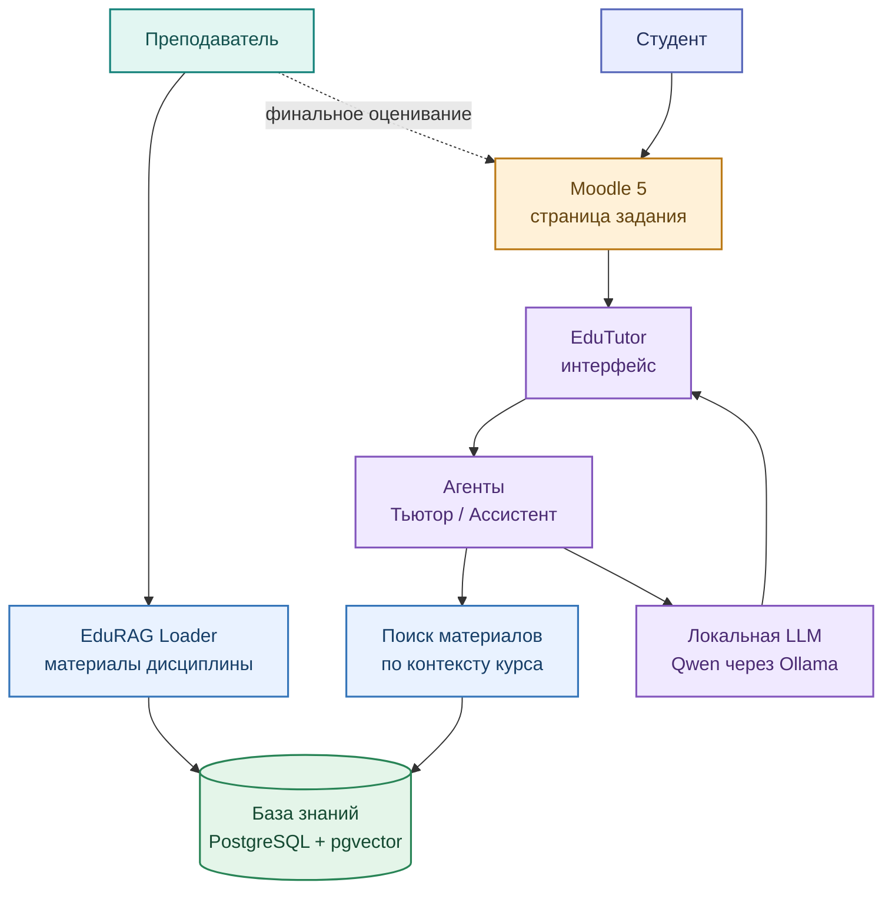

# EduTutor — интеллектуальная поддержка обучения анализу данных

**Грантовый проект «LLM-ассистент для интеллектуальной поддержки обучения анализу данных в магистратуре»**  
**Московский городской педагогический университет · Институт цифрового образования**  
Программа поддержки: **Грантовый конкурс для преподавателей Благотворительного фонда Владимира Потанина (2026)**.

**EduTutor** — образовательная система, которая помогает магистрантам осваивать анализ данных на практических заданиях, а преподавателю — сопровождать выполнение и предварительную проверку работ. Интеллектуальная помощь строится на материалах конкретной дисциплины. **Окончательную оценку выставляет преподаватель.**

> Репозиторий представляет **сам продукт: образовательный сценарий, функции компонентов и архитектуру**. Здесь нет исходного кода, внутренних конфигураций, студенческих работ и решений преподавателя.

## 1. Образовательный маршрут

```mermaid
flowchart LR
    A(["Студент<br/>выбирает задание"]) --> B["Moodle 5<br/>условие и материалы"]
    B --> C["EduTutor<br/>вопросы и разбор ошибок"]
    C --> D["Самостоятельная работа<br/>Python · данные · выводы"]
    D --> E["Отправка работы<br/>в Moodle"]
    E --> F["Преподаватель<br/>проверка и обратная связь"]
    F -. "уточнения и улучшения" .-> D
    classDef student fill:#E9EDFF,stroke:#5666B9,color:#23315D,stroke-width:1.6px;
    classDef teacher fill:#E2F6F2,stroke:#14827A,color:#14524F,stroke-width:1.6px;
    classDef learning fill:#E9F2FF,stroke:#3575B9,color:#173F68,stroke-width:1.6px;
    classDef moodle fill:#FFF1D8,stroke:#BC7B18,color:#664510,stroke-width:1.6px;
    classDef ai fill:#F0E9FF,stroke:#8356BD,color:#4B2B73,stroke-width:1.6px;
    classDef knowledge fill:#E4F5E9,stroke:#288456,color:#154A32,stroke-width:1.6px;
    classDef tech fill:#EDF1F5,stroke:#64768A,color:#35465C,stroke-width:1.5px;
    classDef guard fill:#FFF0EA,stroke:#C2644D,color:#713A2E,stroke-width:1.6px;
    class A student;
    class B,E moodle;
    class C ai;
    class D learning;
    class F teacher;
```

Студент получает помощь **во время** работы, а не готовое решение. Тьютор поясняет постановку задачи, способы сбора и обработки данных, ошибки Python-кода и требования к результату, используя доступные материалы преподавателя.

Преподаватель составляет задания, публикует учебные материалы в базе знаний и может использовать **Агента-Ассистента** для предварительного разбора работ. Решение об оценке остаётся за преподавателем.

| Участник | Что предоставляет EduTutor |
|---|---|
| **Магистрант** | Пояснения по заданиям и терминам, помощь с кодом и интерпретацией результатов, ориентиры для самостоятельной работы |
| **Преподаватель** | Организацию базы учебных знаний, предварительные замечания к работам, поддержку проверки по заданным критериям |
| **Дисциплина** | Связь пояснений с учебной темой, заданием и проверенными материалами |

**Подробно:** [маршрут студента](education/01_student_path.md) · [работа преподавателя](education/02_teacher_path.md) · [дисциплины и учебные активности](education/03_courses.md).

## 2. Дисциплины и практическая подготовка

Проект ориентирован на магистратуру **38.04.05 «Бизнес-информатика»**, профиль **«Бизнес-аналитика и большие данные»**, и первоначально охватывает две дисциплины:

| Дисциплина | Направленность обучения |
|---|---|
| **Python для анализа данных** | Работа с данными средствами Python: подготовка, анализ и представление результатов |
| **Программные средства сбора, консолидации и аналитики данных** | Получение данных из API и веб-источников, очистка, консолидация, аналитика и управленческие выводы |

Практические и лабораторные работы связаны с **конкретными заданиями Moodle**. Учебные материалы могут включать текст условия, индивидуальные варианты, Jupyter Notebook, критерии оценивания и требования к результату. Связь с конкретным вариантом студента является отдельным направлением повышения точности контекста.

## 3. Что входит в продукт

| Компонент | Задача в образовательном процессе | Подробнее |
|---|---|---|
| **EduTutor — Агент-Тьютор** | Поддержка студента при выполнении учебного задания | [Функции EduTutor](services/edututor/README.md) |
| **EduTutor — Агент-Ассистент** | Предварительный анализ работы для преподавателя с Human-in-the-loop | [Функции EduTutor](services/edututor/README.md) |
| **EduRAG Loader** | Подготовка и публикация базы знаний дисциплины преподавателем | [EduRAG Loader](services/edurag_loader/README.md) |
| **Moodle `local_edututor`** | Переход из учебного задания к Тьютору и передача подписанного контекста | [Moodle](services/moodle_edututor/README.md) |

## 4. Как связаны компоненты

В технической части используются **LangGraph**, **MCP**, **PostgreSQL/pgvector**, **модель эмбеддингов E5-large**, локальная **Qwen/Ollama** и интерфейс на базе **CopilotKit / AG-UI**. Состав и связи подробно изложены в [архитектуре системы](architecture/01_overview.md).

## 5. Возможности и развитие

**Реализованная основа продукта:** сервис загрузки и публикации учебных материалов; структурирование дисциплин, тем и занятий; векторное хранилище знаний; агентная архитектура EduTutor; переход из Moodle к помощнику. В EduRAG Loader реализовано структурно-семантическое переранжирование `hybrid_v1` для проверки качества поиска.

**Следующий этап интеграции:** единый механизм поиска для Loader и EduTutor, точное сопоставление задания Moodle и учебной активности, учёт индивидуального варианта и отображение источников непосредственно в ответе. Эти функции не следует считать полностью внедрёнными во все компоненты.

## 6. Навигация по документации

**Обучение:** [студент](education/01_student_path.md) · [преподаватель](education/02_teacher_path.md) · [дисциплины](education/03_courses.md)  
**Архитектура:** [обзор](architecture/01_overview.md) · [агенты](architecture/02_agents.md) · [база знаний и RAG](architecture/03_rag.md) · [Moodle](architecture/04_moodle.md) · [безопасность](architecture/05_security.md)  
**Компоненты:** [EduTutor](services/edututor/README.md) · [EduRAG Loader](services/edurag_loader/README.md) · [плагин Moodle](services/moodle_edututor/README.md)

## Авторство и условия использования

Автор проекта: **Босенко Т. М.**, Московский городской педагогический университет. Работа выполняется при поддержке Благотворительного фонда Владимира Потанина.

Публичная документация распространяется на условиях [CC BY 4.0](LICENSE); сведения для цитирования продукта приведены в [CITATION.cff](CITATION.cff). **Лицензия на документацию не предоставляет доступ к исходному коду продукта.**
