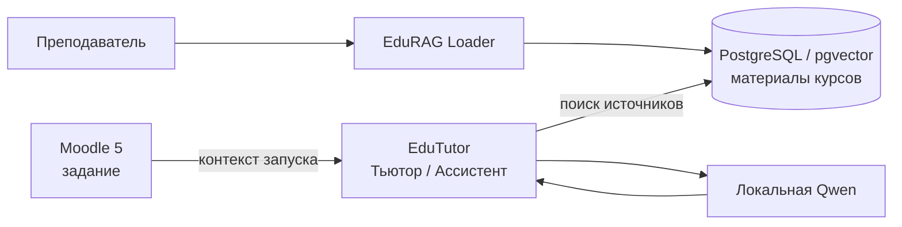

# EduTutor — интеллектуальная поддержка обучения анализу данных

**Грантовый проект «LLM-ассистент для интеллектуальной поддержки обучения анализу данных в магистратуре»**  
Программа поддержки: Грантовый конкурс для преподавателей Благотворительного фонда Владимира Потанина, 2026.  
Организация: Московский городской педагогический университет (МГПУ), Институт цифрового образования.  
Образовательное направление: **38.04.05 «Бизнес-информатика»**, профиль «Бизнес-аналитика и большие данные».

**EduTutor** — система помощи магистрантам и преподавателям при изучении анализа данных. Студент может получать пояснения по заданиям, разбирать ошибки в Python-коде и обращаться к учебным материалам курса. Преподаватель может использовать отдельного агента для предварительной проверки работ; **итоговое оценивание всегда остаётся за преподавателем**.

Публичный репозиторий содержит **только описание грантового проекта, архитектуру, функции сервисов и результаты проверок**. Исходные коды, настройки развёртывания, учебные данные, пароли и внутренние материалы не публикуются.

## Для чего создаётся система

- **Для студента:** помощь при работе над практическими и лабораторными заданиями без замены самостоятельной работы готовым решением.
- **Для преподавателя:** доступ к предварительному анализу работы, выявленным ошибкам и подсказкам для проверки.
- **Для учебного курса:** использование проверенных учебных материалов как основного контекста ответа, с привязкой к дисциплине и заданию.

Система ориентирована прежде всего на две магистерские дисциплины: «Python для анализа данных» и «Программные средства сбора, консолидации и аналитики данных».

## Компоненты проекта

| Компонент | Назначение | Документация |
|---|---|---|
| **Агент-Тьютор** | Объяснения, помощь с заданиями и ошибками в коде | [EduTutor](services/edututor/README.md) |
| **Агент-Ассистент** | Предварительная проверка с контролем преподавателя | [EduTutor](services/edututor/README.md) |
| **EduRAG Loader** | Загрузка и индексация материалов преподавателя в базу знаний | [EduRAG Loader](services/edurag_loader/README.md) |
| **Moodle `local_edututor`** | Запуск Тьютора со страницы задания Moodle 5 | [Интеграция с Moodle](services/moodle_edututor/README.md) |
| **База знаний и LLM** | PostgreSQL/pgvector, поиск фрагментов и генерация пояснений локальной Qwen | [Архитектура](architecture/01_overview.md) |

## Как взаимодействуют сервисы

Учебные материалы сначала загружаются преподавателем через Loader. Тьютор использует материалы из базы знаний для ответа. Moodle служит точкой входа в конкретное задание, но не выполняет генерацию и не выставляет оценки автоматически.

## Текущее состояние и ближайшие изменения

**Реализовано:** каталог дисциплин и занятий в EduRAG Loader 3.1; загрузка учебных файлов, предпросмотр и публикация в pgvector; диагностический поиск `hybrid_v1`; запуск EduTutor из Moodle через отдельный плагин; механизмы агентов и локальной языковой модели по документации системы.

**Требует доработки/совместной проверки:** использование `hybrid_v1` непосредственно в EduTutor; точная передача идентификатора занятия и варианта из Moodle в retrieval; показ подтверждающих источников в интерфейсе; сквозные проверки «Moodle → EduTutor → ответ» на актуальном стенде.

Это **описание состояния**, а не заявление о полной готовности всех интеграций. Подробнее — [конвейер RAG](architecture/05_rag_pipeline.md) и [результаты проверок](smoke_tests/README.md).

## Навигация

- [Архитектура системы](architecture/01_overview.md) — общая схема, агенты, MCP, RAG, защита данных и Moodle.
- [Описание сервисов](services/edututor/README.md) — функции Tutor, Loader и Moodle-моста.
- [Проверки работоспособности](smoke_tests/README.md) — краткие подтверждённые результаты и ограничения.

## Поддержка и права

Работа выполняется при поддержке **Благотворительного фонда Владимира Потанина** в рамках грантового проекта МГПУ. Автор проекта: **Босенко Т. М.**

Документация предоставляется по лицензии [Creative Commons Attribution 4.0 International](LICENSE). Правила цитирования: [CITATION.cff](CITATION.cff). Лицензия на эту документацию **не означает публикацию исходного кода** программной системы.
