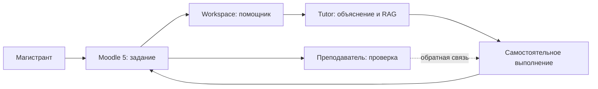
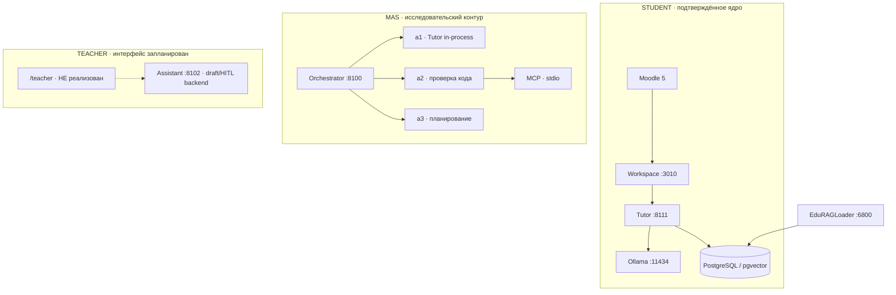

# EduTutor — интеллектуальная поддержка обучения анализу данных

**Грантовый проект «LLM-ассистент для интеллектуальной поддержки обучения анализу данных в магистратуре»**  
**Московский городской педагогический университет · Институт цифрового образования**  
**Благотворительный фонд Владимира Потанина · грант № ГСГК-064/26 (2026)**

**EduTutor** — образовательная LLM-система для поддержки магистрантов при выполнении заданий по анализу данных. Тьютор помогает работать с условиями, кодом и учебными материалами; преподаватель определяет критерии и принимает итоговые решения об оценивании. Исследовательский контур проекта посвящён **верифицируемой многоагентной оркестрации**.

> **Область публикации.** Этот репозиторий содержит публичное описание образовательного продукта, архитектуры, компонентов и исследовательских направлений. Исходный код рабочего прототипа, локальные конфигурации, пароли, учебные данные и персональные сведения здесь **не публикуются**. Сведения о проверках ниже относятся к зафиксированному испытанию **25 октября 2026 года**, а не к текущему доступу к сервисам.

## 1. Образовательный маршрут

Тьютор поясняет постановку задачи, подходы к обработке данных, ошибки Python/SQL и смысл результатов. Он не должен раскрывать закрытые эталонные решения или заменять самостоятельную работу. Преподаватель управляет учебным содержанием и итоговой оценкой.

[Маршрут студента](education/01_student_path.md) · [Маршрут преподавателя](education/02_teacher_path.md) · [Дисциплины](education/03_courses.md)

## 2. Поддерживаемые дисциплины

Проект ориентирован на магистратуру **38.04.05 «Бизнес-информатика»**, профиль **«Бизнес-аналитика и большие данные»**.

| Дисциплина | Учебное содержание | Состояние базы знаний на испытании 25.10.2026 |
|---|---|---|
| **Python для анализа данных** | Подготовка, анализ и визуализация данных средствами Python | 0 фрагментов; наполнение впереди |
| **Программные средства сбора, консолидации и аналитики данных** | API, HTML, очистка, консолидация, аналитика и управленческие выводы | 712 фрагментов; Tutor/RAG проверены |

Число фрагментов — исторический результат испытаний, не постоянный показатель состояния БД.

## 3. Архитектура: три независимых контура

**Важно:** STUDENT, MAS и TEACHER — разные пути. Успешный `/tutor/complete` не доказывает выполнение Orchestrator; агент `a1` использует Tutor *in-process*, а не вызов HTTP :8111. Для MCP используется **stdio**, HTTP-сервис :8000 в проверенном профиле не нужен. Teacher UI, серверный RBAC и полный HITL E2E ещё не внедрены.

[Общая архитектура](architecture/01_overview.md) · [Агенты и MCP](architecture/02_agents.md) · [RAG](architecture/03_rag.md) · [Moodle](architecture/04_moodle.md) · [Безопасность](architecture/05_security.md)

## 4. Сервисы прототипа

| Компонент | Интерфейс | Роль |
|---|---|---|
| **Workspace** | :3010 | Студенческий Next.js/CopilotKit интерфейс |
| **Tutor** | :8111, `/tutor/complete` | LLM-ответы с контекстом RAG |
| **Orchestrator** | :8100 | Маршрутизация, граф, делегирование агентам |
| **Assistant** | :8102 | Предварительные замечания, HITL backend; без готового teacher UI |
| **EduRAGLoader** | :6800 | Каталог, подготовка материалов; в испытании — безопасный read-only просмотр |
| **MCP** | stdio | Инструменты валидации и работы с ресурсами; не отдельный HTTP :8000 |
| **Ollama** | :11434 | Локальная модель семейства Qwen |
| **PostgreSQL/pgvector** | удалённый :5432 | Хранение и семантический поиск учебных фрагментов |
| **Moodle 5** | внешний LMS | Курсы, задания, подписанный запуск помощника |

Порты приведены как сведения об **испытанной конфигурации**, а не как публичные сетевые адреса или инструкция развертывания.

## 5. Подтверждённая работоспособность и ограничения

На срезе испытаний **25.10.2026**:

- **PASS:** Workspace/Tutor, ответ локальной модели не в mock-режиме, поиск RAG по наполненному курсу; EduRAGLoader в режиме read-only GET; health основных сервисов.
- **PASS в отдельном тестовом процессе:** сценарии `a1`, MCP `validate_code` у `a2`, черновик Assistant.
- **NOT_VERIFIED:** вызов MCP непосредственно через действующие AG-UI процессы Orchestrator/Assistant; запуск Moodle с реальной HMAC-сессией.
- **NOT_IMPLEMENTED / DEFERRED:** `/teacher` и полный преподавательский HITL E2E; РПД отложены по решению проекта.
- **NOT_STARTED:** новые научные испытания K1–K4 после консолидации.

Не смешивать проверки companion с пользовательскими E2E и историческую научную апробацию (5220 запросов) с новыми тестами. [Реестр статусов](architecture/06_verification.md).

## 6. Описание компонентов и исследования

**Учебный контур:** [EduTutor](services/edututor/README.md) · [EduRAGLoader](services/edurag_loader/README.md) · [Moodle `local_edututor`](services/moodle_edututor/README.md).

**Исследование:** модель оркестрации — граф M, классификация τ, переходы δ, каталог компетенций Θ, доказательные трассы λ, безопасный отказ и Human-in-the-loop. Наличие кода, прохождение изолированного теста и сквозное подтверждение различаются. [Подробности об агентах](architecture/02_agents.md).

**ВКР:** [отдельное исследование интеграции и гибридного поиска с выдачей первоисточников](tutor-loader-vkr/README.md). Не считать проектируемые механизмы поиска уже внедрёнными в основной Tutor.

## Авторство и использование

Автор проекта — **Босенко Т. М.**, Московский городской педагогический университет. Работа выполняется при поддержке Благотворительного фонда Владимира Потанина.

Публичная документация — [CC BY 4.0](LICENSE); информация для цитирования — [CITATION.cff](CITATION.cff). Лицензия документации не означает публикацию исходного кода рабочего прототипа.
