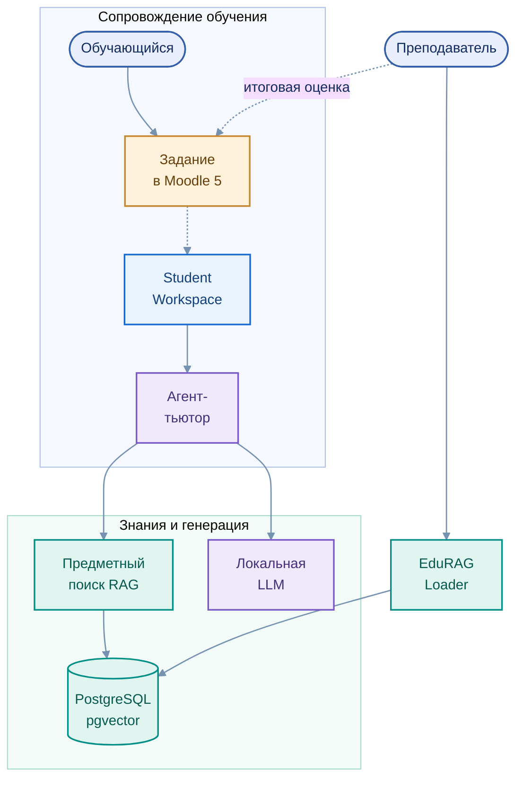
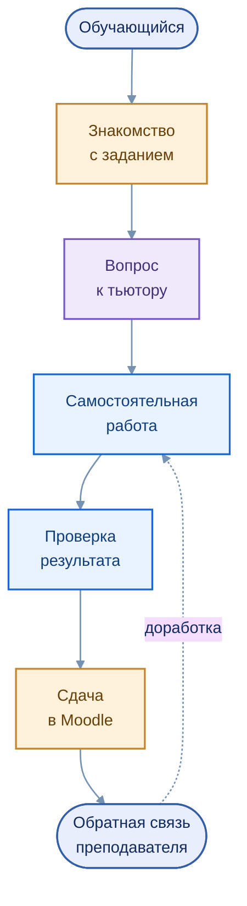
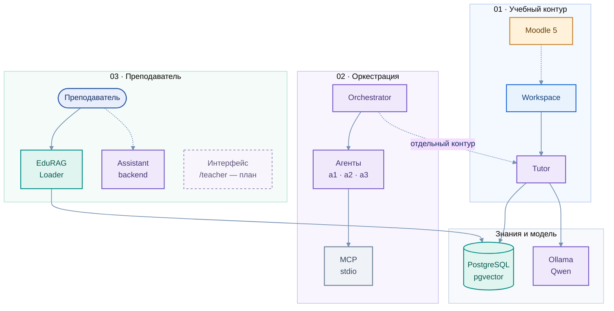

# EduTutor

**Интеллектуальная платформа сопровождения обучения в цифровой образовательной среде**

EduTutor — разрабатываемая образовательная система на основе больших языковых моделей и предметных баз знаний. Платформа объединяет поддержку самостоятельной работы обучающихся, управление учебными материалами и агентные сервисы для преподавателя.

Проект развивается в **Московском городском педагогическом университете (МГПУ), Институт цифрового образования**, при поддержке **Благотворительного фонда Владимира Потанина** — «LLM-ассистент для интеллектуальной поддержки обучения анализу данных в магистратуре».

[Образовательные сценарии](education/README.md) · [Архитектура](architecture/01_overview.md) · [Технологический стек](architecture/06_technology_stack.md) · [Компоненты](services/edututor/README.md)

## Технологический стек

**Интерфейс и образовательная среда**

   

**Агенты и серверные сервисы**

    

**Модели, поиск и хранение данных**

     

[Назначение технологий и их взаимодействие](architecture/06_technology_stack.md)

## Концепция платформы

Редактируемая диаграмма: [`edututor_overview.mmd`](assets/edututor_overview.mmd)

**Основной принцип — поддержка самостоятельного решения учебной задачи.** Агент-тьютор помогает разобрать формулировку задания, объяснить методы, выявить ошибки кода и интерпретировать результаты. Ответы могут использовать материалы конкретной дисциплины из базы знаний. Преподаватель определяет критерии и сохраняет ответственность за итоговое оценивание.

## Образовательный охват

EduTutor проектируется как **расширяемая платформа для образовательных программ разных уровней и профилей**, а не как решение, ограниченное одной магистерской программой.

| Образовательный трек | Примеры учебных задач |
|---|---|
| **Бизнес-информатика и аналитика данных** | Python, SQL, сбор и консолидация данных, аналитические выводы |
| **Педагогическое образование** | Цифровые технологии обучения, анализ образовательных данных, методические сценарии |
| **Информатика и программная инженерия** | Алгоритмы, базы данных, работа с кодом, информационный поиск |
| **Робототехника и IoT** | Телеметрия, потоки данных, обработка сигналов, учебные эксперименты |
| **Машинное обучение и интеллектуальные системы** | Подготовка данных, построение моделей, анализ качества |
| **Информационная безопасность** | Разбор технических заданий, моделирование ситуаций, оценка решений |

В рамках **первоначального грантового сценария** прорабатываются дисциплины «Python для анализа данных» и «Программные средства сбора, консолидации и аналитики данных» для направления 38.04.05 «Бизнес-информатика». Другие направления обозначают область **масштабирования архитектуры и методических сценариев**, а не перечень уже завершённых внедрений.

[Образовательные треки и дисциплины](education/03_courses.md)

## Сценарий обучения

Редактируемая диаграмма: [`learning_journey.mmd`](assets/learning_journey.mmd)

Взаимодействие начинается с задания в образовательной среде. Обучающийся выполняет работу самостоятельно и обращается к интеллектуальному помощнику за предметными пояснениями. Результат и итоговая обратная связь остаются частью учебного процесса, организованного преподавателем.

## Архитектура

Редактируемая диаграмма: [`platform_architecture.mmd`](assets/platform_architecture.mmd)

| Контур | Основные компоненты | Назначение |
|---|---|---|
| **Учебный** | Moodle 5, Student Workspace, Tutor, RAG | Контекстная поддержка обучающегося |
| **Многоагентный** | Orchestrator, специализированные агенты, MCP | Маршрутизация запросов и подключение инструментов |
| **Преподавательский** | EduRAG Loader, Assistant backend | Управление материалами и подготовка рекомендаций |
| **Инфраструктурный** | PostgreSQL/pgvector, Ollama/Qwen | Поиск знаний и локальный вывод модели |

Студенческий Tutor и Orchestrator представляют **разные контуры взаимодействия**. Отдельный интерфейс преподавателя `/teacher` и сквозной цикл согласования оценивания относятся к развитию платформы. Не все функции агентной оркестрации следует считать встроенными в каждый запрос студенческого интерфейса.

## Программные компоненты

| Компонент | Функции | Подробнее |
|---|---|---|
| **EduTutor** | Диалог, разбор задач, анализ кода, предметный поиск | [Агент-тьютор](services/edututor/README.md) |
| **Orchestrator** | Управление специализированными агентами | [Агенты и маршрутизация](architecture/02_agents.md) |
| **EduRAG Loader** | Дисциплины, темы, материалы и операции управления базой знаний | [Сервис загрузки](services/edurag_loader/README.md) |
| **Moodle `local_edututor`** | Передача учебного контекста в интерфейс помощника | [Интеграция Moodle](services/moodle_edututor/README.md) |
| **Assistant backend** | Подготовка предварительных замечаний преподавателю | [Сценарий преподавателя](education/02_teacher_path.md) |

## Разработка и развитие

В составе EduTutor реализованы студенческий интерфейс и агент-тьютор, серверные компоненты оркестрации, предметный поиск и EduRAG Loader с управлением учебной структурой. Интеграция всех компонентов в единые сквозные образовательные процессы развивается поэтапно.

Ближайшие архитектурные направления: расширение образовательных треков, повышение прослеживаемости ответов до исходных учебных материалов, совершенствование поиска и поддержка преподавательских сценариев с обязательным участием человека в принятии решений.

Публичная документация представляет **назначение продукта, его архитектуру и направления развития**. Она не является инструкцией доступа к рабочей инфраструктуре и не содержит закрытых конфигураций.

## Документация

| Область | Разделы |
|---|---|
| Образование | [Образовательные сценарии](education/README.md) · [Путь обучающегося](education/01_student_path.md) · [Роль преподавателя](education/02_teacher_path.md) · [Треки и дисциплины](education/03_courses.md) |
| Архитектура | [Обзор](architecture/01_overview.md) · [Агенты](architecture/02_agents.md) · [RAG](architecture/03_rag.md) · [Moodle](architecture/04_moodle.md) · [Принципы безопасности](architecture/05_security.md) · [Технологии](architecture/06_technology_stack.md) |
| Компоненты | [EduTutor](services/edututor/README.md) · [EduRAG Loader](services/edurag_loader/README.md) · [Плагин Moodle](services/moodle_edututor/README.md) |
| Исследовательские и квалификационные проекты | [Развитие сервиса поиска и работы с первоисточниками](tutor-loader-vkr/README.md) |
| Диаграммы | [Редактируемые исходники Mermaid](assets/README.md) |

---

**Автор проекта:** Босенко Т. М. · Московский городской педагогический университет.

**Поддержка проекта:** Благотворительный фонд Владимира Потанина, грант ГСГК-064/26.

Документация: [лицензия](LICENSE) · [сведения для цитирования](CITATION.cff). Публикация документации не означает открытого распространения исходных кодов внутренних сервисов.
