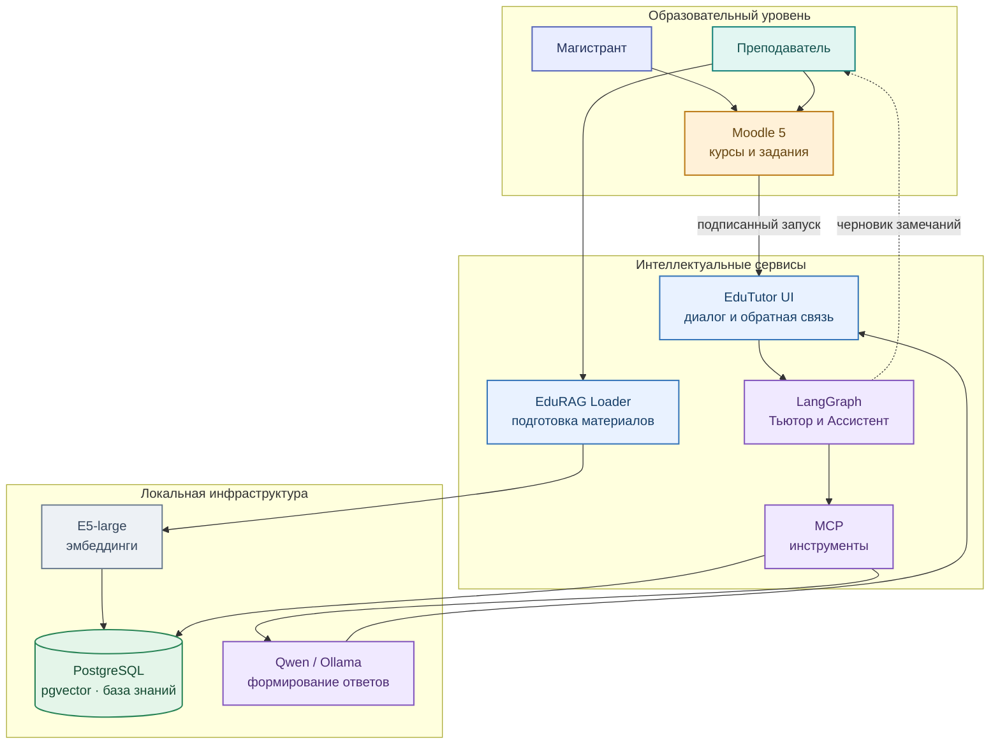

# Архитектура системы

[← Главная](../README.md) · [Образовательный маршрут](../education/01_student_path.md)

Архитектура следует учебному процессу: **преподаватель задаёт содержание**, **Moodle предоставляет контекст занятия**, **EduTutor помогает обучающемуся**, а **человек сохраняет контроль над оцениванием**.

## Архитектура продукта

## Границы ответственности

- **Moodle** хранит учебные задания и запускает помощника, но не генерирует ответы.
- **EduRAG Loader** принимает проверенные преподавателем материалы, публикует фрагменты и эмбеддинги.
- **EduTutor** использует найденные материалы в диалоге и для предварительной проверки работ.
- **PostgreSQL/pgvector** хранит учебный индекс; **Qwen/Ollama** формирует пояснение на основе переданного контекста.
- **Преподаватель** отвечает за критерии и итоговую оценку.

## Подробные схемы

[Агенты и интерфейсы](02_agents.md) · [База знаний и RAG](03_rag.md) · [Интеграция Moodle](04_moodle.md) · [Защита данных](05_security.md)
