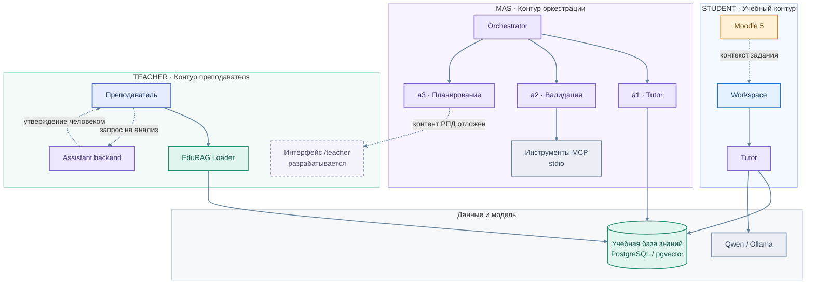

# Архитектура EduTutor

[← На главную](../README.md) · [Агенты](02_agents.md) · [RAG](03_rag.md)

EduTutor соединяет **образовательный процесс**, **предметный информационный контекст** и **интеллектуальные сервисы**. Архитектура организована так, чтобы преподаватель отвечал за содержание курса, LMS — за учебные активности, а помощник — за сопровождение работы с данными.

**Архитектура трёх контуров**

Исходник схемы: [`platform_architecture.mmd`](../assets/platform_architecture.mmd)

## Три контура

### 01 · STUDENT — обучение

`Moodle 5 → Student Workspace → Агент-Тьютор → RAG / Ollama`

Магистрант открывает задание в Moodle, задаёт вопросы и получает пояснения по предмету, условиям работы и ошибкам кода. Tutor использует локальную языковую модель и доступный RAG-контекст.

### 02 · MAS — интеллектуальная оркестрация

`Orchestrator → специализированные агенты → MCP-инструменты`

Контроллер распределяет запросы по компетенциям и маршрутам, а специализированные агенты выполняют отдельные задачи. Технологии LangGraph и MCP используются для исследования управляемости и проверяемости многоагентных процессов. Это **отдельный контур**, который не следует отождествлять со всеми запросами студенческого Tutor.

### 03 · TEACHER — подготовка содержания и обратная связь

`Преподаватель → EduRAG Loader → база знаний`  
`Работа студента → Assistant backend → предварительные замечания → преподаватель`

EduRAG Loader организует учебный контент. Backend Агента-Ассистента предназначен для предварительного анализа, но отдельный интерфейс `/teacher` и полноценный цикл утверждения оценки относятся к дальнейшему развитию.

## Основные технологические компоненты

| Уровень | Компоненты | Роль |
|---|---|---|
| Образовательный | Moodle 5, учебные задания | Курсы, варианты, сдача работы |
| Представление | Next.js, CopilotKit / AG-UI | Пользовательский диалог |
| Агентный | Tutor, Orchestrator, Assistant, LangGraph | Пояснения, маршрутизация, черновая обратная связь |
| Инструментальный | MCP stdio | Вызов специализированных функций |
| Информационный | EduRAG Loader, PostgreSQL, pgvector | Подготовка и поиск материала |
| Генеративный | Ollama, Qwen | Формирование предметных пояснений |

## Ответственность компонентов

**Moodle** остаётся системой учебных заданий. **EduRAG Loader** организует содержание дисциплин. **Tutor** сопровождает студента. **Orchestrator** исследует управляемую координацию агентов. **Преподаватель** утверждает образовательные решения.

[Агенты и управление](02_agents.md) · [Поиск материалов](03_rag.md) · [Moodle](04_moodle.md) · [Ответственность и данные](05_security.md)
