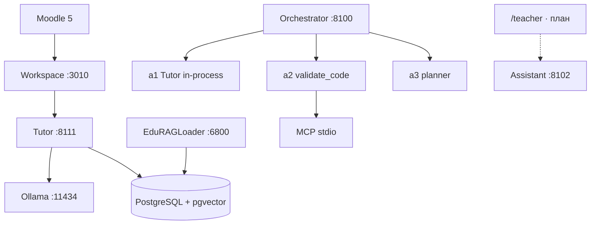

# Архитектура EduTutor

[← Главная](../README.md) · [Агенты](02_agents.md) · [Проверка реализации](06_verification.md)

Архитектура после консолидации прототипа описывается **тремя независимыми контурами**. Ниже приведены логические компоненты, без приватных адресов, команд развертывания и исходного кода.

| Контур | Фактическая цепочка | Уровень готовности (испытания 25.10.2026) |
|---|---|---|
| **STUDENT** | Moodle → Workspace :3010 → Tutor :8111 → Ollama и PostgreSQL/pgvector | Tutor/Workspace/RAG **PASS**; живой HMAC launch **NOT_VERIFIED** |
| **MAS** | Orchestrator :8100 → a1/a2/a3; MCP stdio | Health/routing и companion a1/a2 **PASS**; live AG-UI MCP **NOT_VERIFIED** |
| **TEACHER** | Планируемый `/teacher` → BFF → Assistant :8102 | Backend draft проверен в companion; UI/RBAC/HITL E2E **NOT_IMPLEMENTED** |

**Границы:** Tutor для Student отвечает по HTTP `/tutor/complete`, а `a1` в Orchestrator импортирует модуль Tutor внутри процесса. Студенческий путь не требует MCP. Инструментальные вызовы MAS используют stdio MCP. Ассистент подготавливает **черновик**, но не выставляет оценку в журнал Moodle автоматически.

**Прототип** включает Workspace, Tutor, Orchestrator, Assistant, MCP, shared, Moodle plugin mirror и EduRAGLoader. Публичный репозиторий при этом сохраняет роль **архитектурно-образовательного описания**, а не зеркала закрытого рабочего дерева.

[База знаний](03_rag.md) · [Связь с Moodle](04_moodle.md) · [Контроль доступа](05_security.md)
