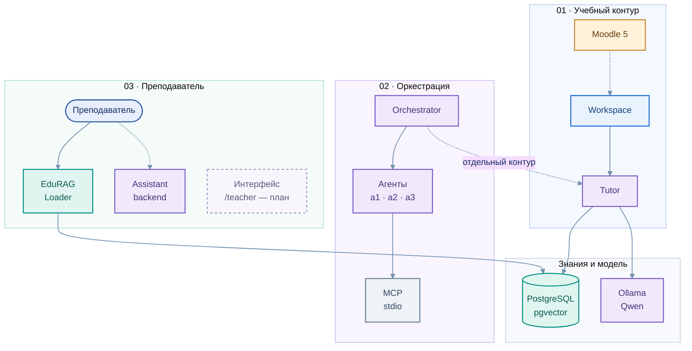

# Архитектура платформы

[← EduTutor](../README.md) · [Технологии](06_technology_stack.md) · [Агенты](02_agents.md)

EduTutor объединяет образовательную среду, интерфейсы взаимодействия, агентные сервисы и предметную базу знаний. Каждый уровень имеет собственную область ответственности; развитие платформы предусматривает независимое расширение программных компонентов и учебных сценариев.

## Основные контуры

Редактируемая диаграмма: [`platform_architecture.mmd`](../assets/platform_architecture.mmd)

### Учебный контур

**Moodle 5 → Student Workspace → Агент-тьютор → предметный RAG / LLM.** Обучающийся получает пояснения в контексте дисциплины, выполняет задания и передаёт результат через принятую в образовательной организации систему обучения. Преподаватель оценивает результат.

### Контур агентной оркестрации

**Orchestrator → специализированные агенты → инструменты MCP.** Маршрутизатор определяет способ обработки запроса с учётом компетенций и предусмотренных управляющих переходов. Этот исследовательский контур архитектурно отделён от штатного запроса Tutor.

### Контур преподавателя

**EduRAG Loader → база знаний** обеспечивает управление структурой учебных материалов. **Assistant backend** ориентирован на подготовку предварительной обратной связи. Полноценный интерфейс `/teacher` и завершённый процесс принятия решений преподавателем развиваются отдельно.

## Технологические уровни

| Уровень | Решения | Назначение |
|---|---|---|
| Образовательная среда | Moodle 5, учебные активности | Задания, взаимодействие и оценивание |
| Интерфейсы | Next.js, CopilotKit, AG-UI | Учебный диалог и взаимодействие с сервисами |
| Агентная логика | Python, FastAPI, LangGraph, MCP | Обработка запросов и координация инструментов |
| Учебные материалы | EduRAG Loader, Flask | Каталог и управление содержанием дисциплин |
| Поиск и хранилище | PostgreSQL, pgvector, RAG | Извлечение контекста для ответа |
| Генеративная модель | Ollama, Qwen; модель эмбеддингов E5 | Локальное формирование ответа и представлений текста |

## Архитектурные принципы

- **Модульность:** образовательный контур и исследовательская оркестрация развиваются независимо.
- **Контекстность:** содержательное основание ответа задают материалы курса и учебное задание.
- **Прослеживаемость:** развитие системы ориентировано на связь найденного фрагмента с первоисточником.
- **Контроль преподавателя:** интеллектуальная рекомендация не заменяет итоговое оценивание.
- **Расширяемость:** образовательный профиль задаётся материалами, заданиями и правилами работы, а не жёстко зашивается в архитектуру.

[Агенты](02_agents.md) · [База знаний](03_rag.md) · [Границы ответственности](05_security.md)
