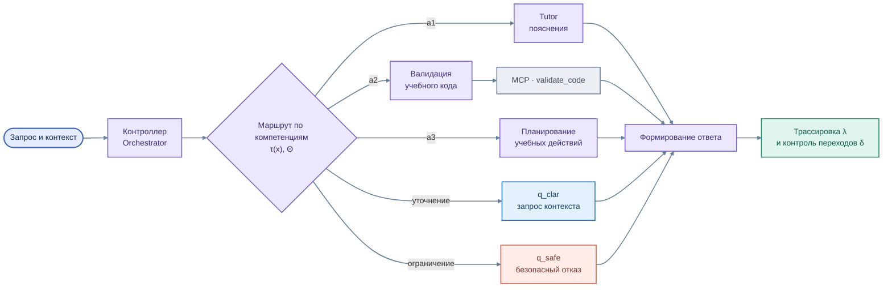

# Интеллектуальные агенты и оркестрация

[← Архитектура](01_overview.md) · [Tutor и Assistant](../services/edututor/README.md)

Архитектура разделяет **помощь магистранту в выполнении работы** и **инструменты сопровождения преподавателя**. В исследовательском контуре Orchestrator организует переходы между специализированными агентами и инструментами.

**Цветная схема многоагентной оркестрации**

Исходник схемы: [`agent_orchestration.mmd`](../assets/agent_orchestration.mmd)

## Роли агентов

| Агент | Область ответственности | Предполагаемый результат |
|---|---|---|
| **a1 · Tutor** | Разъяснение учебных вопросов и предметный RAG | Понятное объяснение, связанное с курсом |
| **a2 · Проверка** | Анализ и валидация учебного кода средствами MCP | Замечания к решению, подсказки по исправлению |
| **a3 · Планирование** | Подготовка последовательности учебных действий | План дальнейшей работы; расширение источников знаний отложено |
| **q_clar / q_safe** | Уточнение недостаточного контекста и безопасный отказ | Контролируемый ответ вместо неопределённого действия |

## Исследовательская модель

Управление рассматривается как верифицируемый процесс: запрос получает классификацию **τ**, маршрут определяется по компетенциям **Θ**, переходы фиксируются функцией **δ** и графом состояний **M**. Подход предполагает возможность связывать действия с доказательной трассой **λ**.

Это **описание архитектурной и научной модели**. Фактическая полнота её реализации и оценка качества требуют отдельного исследования; здесь не приводятся необоснованные экспериментальные показатели.

## Tutor и Assistant — не одно и то же

**Агент-Тьютор** сопровождает студента: объясняет терминологию, помогает анализировать Python-код и ориентироваться в материалах дисциплины.  
**Агент-Ассистент** предназначен для преподавателя: формирует предварительную обратную связь по выполненной работе и критериям.

Заявленный принцип **Human-in-the-loop** означает, что решение об оценке сохраняется за преподавателем. Наличие backend не означает готовности отдельного преподавательского UI или автоматической записи оценки в Moodle.

## Технологии

- **LangGraph** — моделирование агентных состояний и переходов.
- **MCP (stdio)** — инструментальный интерфейс для специализированных функций.
- **RAG** — получение релевантных материалов дисциплины.
- **Ollama / Qwen** — локальная генерация пояснений.
- **CopilotKit / AG-UI** — интерфейс взаимодействия с интеллектуальными сервисами.

[Общая архитектура](01_overview.md) · [EduTutor](../services/edututor/README.md) · [Материалы и RAG](03_rag.md)
