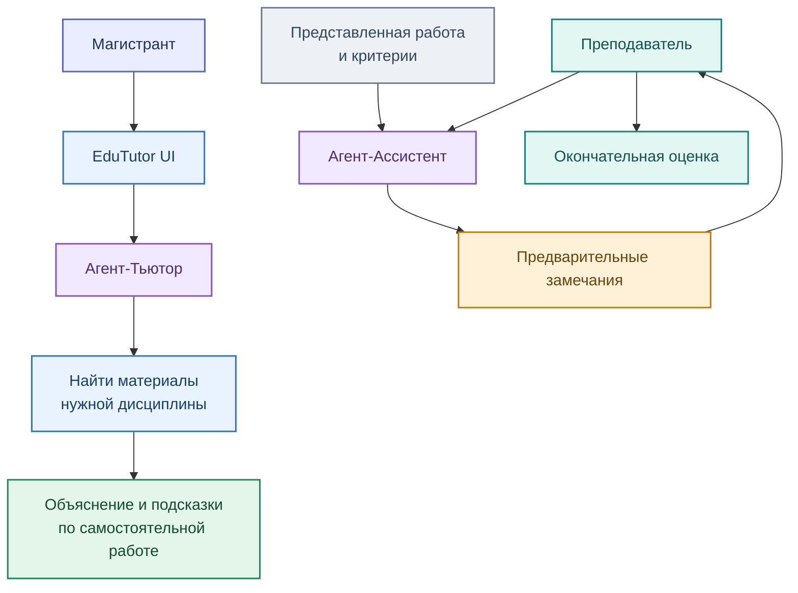

# Агенты и интерфейсы EduTutor

[← Архитектура](01_overview.md) · [Сервис EduTutor](../services/edututor/README.md)

В продукте разделены **два образовательных сценария**: сопровождение студента и помощь преподавателю в проверке. Для организации их действий используется LangGraph; интерфейс построен на технологиях CopilotKit / AG-UI, инструменты подключаются через MCP.

## Два сценария использования

### Агент-Тьютор

Объясняет термины и задания, помогает находить причины ошибок и понимать результаты анализа. Подсказки должны соответствовать учебным материалам, доступным студенту; закрытые эталоны решений в ответах недопустимы.

### Агент-Ассистент

Готовит преподавателю замечания по работе и критериям. Это **предварительный разбор**, а не автономное выставление оценок. Преподаватель проверяет и при необходимости корректирует результат.

### Технологический слой

**LangGraph** организует последовательность действий агентов, **MCP** обеспечивает доступ к разрешённым инструментам (поиск знаний, проверка кода, журнал действий), а **Qwen через Ollama** формирует текстовые пояснения. Состав доступных инструментов зависит от рабочего контура и прав пользователя.

[Как материалы попадают в ответы →](03_rag.md)
