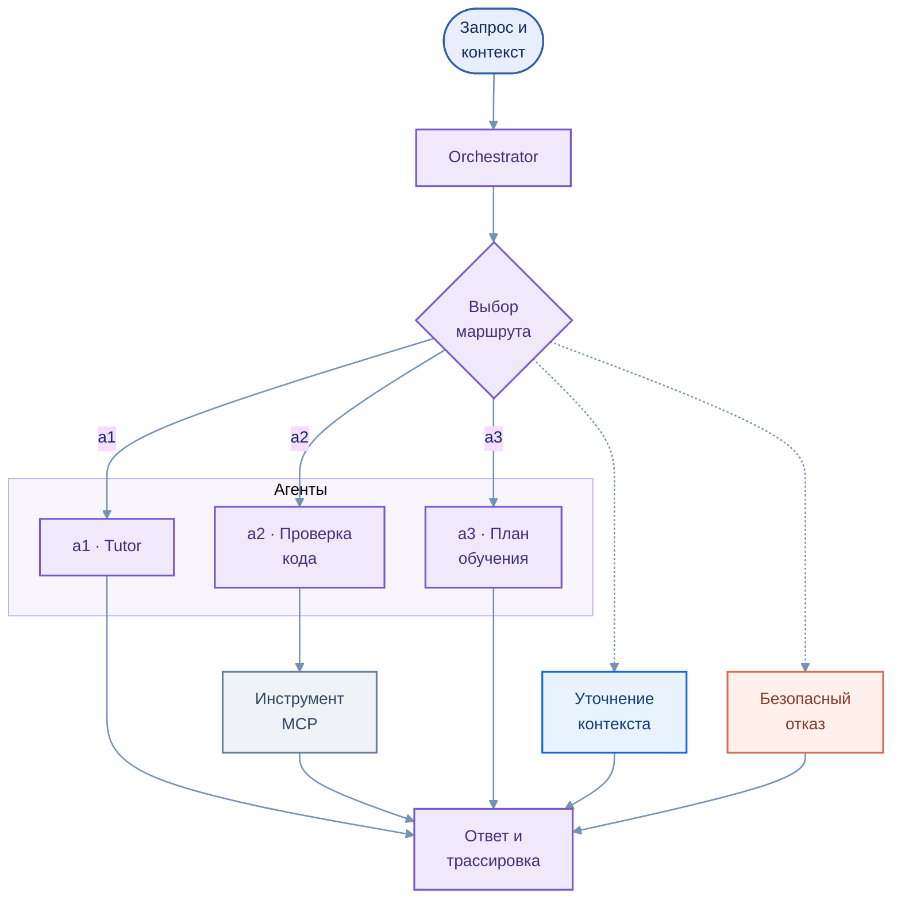

# Интеллектуальные агенты и оркестрация

[← Архитектура](01_overview.md) · [EduTutor](../services/edututor/README.md)

Агентная архитектура EduTutor предусматривает распределение задач между специализированными компонентами. **Агент-тьютор** ориентирован на взаимодействие с обучающимся; **Агент-ассистент** — на поддержку преподавателя; **Orchestrator** — на управление маршрутизацией в отдельном многоагентном контуре.

## Логика маршрутизации

Редактируемая диаграмма: [`agent_orchestration.mmd`](../assets/agent_orchestration.mmd)

| Компонент | Область применения |
|---|---|
| **a1 — Tutor** | Предметные пояснения и поддержка учебных действий |
| **a2 — проверка кода** | Валидация учебных решений средствами инструментов MCP |
| **a3 — планирование** | Построение последовательности действий; подключение РПД отложено |
| **Уточнение и безопасный отказ** | Обработка недостаточного контекста и ограничений маршрута |

## Научная концепция

Исследовательская модель использует граф состояний **M**, функцию выбора маршрута **τ**, каталог компетенций **Θ**, переходы **δ** и трассировку действий **λ**. Эти понятия описывают способ организации и анализа управляемой агентной системы; наличие соответствующих компонентов не равнозначно завершённой проверке всех свойств модели.

## Роль преподавателя

Инструменты могут формировать предварительные замечания, предложения по доработке и объяснения. **Утверждение оценки остаётся за преподавателем**. Отдельный пользовательский интерфейс преподавателя и сквозной Human-in-the-loop workflow являются направлениями развития.

## Технологическая основа

    

[Технологический стек](06_technology_stack.md) · [Поиск по учебным материалам](03_rag.md)
