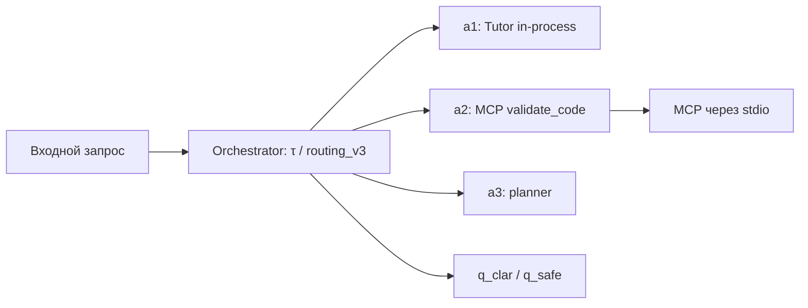

# Агенты, управление и MCP

[← Архитектура](01_overview.md) · [Статусы проверок](06_verification.md)

## Образовательные роли

- **Агент-Тьютор:** поясняет учебное задание, инструменты Python/SQL, ошибки и результаты на основе доступной базы знаний. Студенческий Tutor :8111 функционально проверен.
- **Агент-Ассистент:** формирует предварительный разбор работы и замечания по критериям; преподаватель сохраняет право окончательного решения. Backend :8102 и companion draft проверены, но полноценный `/teacher`/HITL E2E ещё не реализован.
- **Orchestrator:** отдельный исследовательский сервис :8100, управляющий маршрутизацией и передачей запроса специализированным агентам.

## Верифицируемая оркестрация

В исследовательской модели используются: классификация **τ**, графовый автомат **M**, функция управляющих переходов **δ**, каталог компетенций **Θ**, доказательная трасса **λ**, состояния уточнения/безопасного отказа и Human-in-the-loop. Эти понятия обозначают исследуемую архитектуру; **они не являются утверждением, что все научные критерии уже испытаны**.

В прототипе MCP-сервер и клиенты используют изолированные Python-окружения с различными major-версиями SDK и согласованным **stdio**-транспортом. HTTP-порт MCP :8000 не требуется для подтверждённого профиля. Возможность вызова MCP через работающие live AG-UI endpoints отдельно **NOT_VERIFIED**, хотя companion a2 и draft Assistant прошли тесты.

В контуре a3 ресурсы РПД (`rpd://`) не являются обязательным содержимым текущего этапа: **РПД DEFERRED**. Отсутствие заполненного корпуса РПД не следует трактовать как общую неисправность MCP.

[Сценарий студента](../education/01_student_path.md) · [Сценарий преподавателя](../education/02_teacher_path.md)
