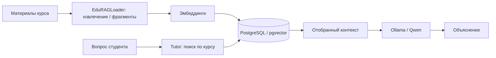

# Образовательная база знаний и RAG

[← Архитектура](01_overview.md) · [EduRAGLoader](../services/edurag_loader/README.md)

Учебные материалы преподавателя организуются по дисциплинам, темам и занятиям, извлекаются в текстовые фрагменты и индексируются для поиска по смыслу. Tutor использует релевантные фрагменты как контекст для локальной LLM. Хранилище — **PostgreSQL/pgvector**.

## Разделение функций

- **EduRAGLoader** отвечает за подготовку/каталогизацию материалов и диагностический поиск; в подтверждённом испытании был запущен в режиме **read-only**, без импорта и публикации новых документов.
- **Tutor** использует отдельный поисковый путь RAG; на синтетическом вопросе выполнены реальный ответ модели и извлечение пяти фрагментов.
- `hybrid_v1` — известный механизм диагностического переранжирования в Loader, **не доказательство его внедрения во все ответы Tutor**. Интеграция гибридного поиска и визуальная выдача первоисточника исследуются отдельно, в том числе в [проекте ВКР](../tutor-loader-vkr/README.md).

## Состояние наполнения на испытании 25.10.2026

| Дисциплина | Ключ | Фрагменты |
|---|---|---:|
| Программные средства сбора, консолидации и аналитики данных | `data_collection_analytics` | **712** |
| Python для анализа данных | `python_data_analysis` | **0** |

Это исторический срез БД. Количество фрагментов не гарантируется при будущих запусках. Отсутствие наполнения курса A ограничивает качество ответов по его материалам.

**Доступность источников:** нельзя выдавать преподавательские эталоны за общедоступный учебный контент. РПД отложены и не включены в ближайшую программу наполнения.
