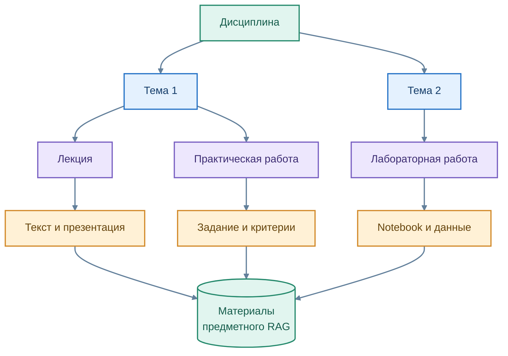

# Предметная база знаний и RAG

[← Архитектура](01_overview.md) · [EduRAG Loader](../services/edurag_loader/README.md)

Качество учебной поддержки зависит не только от языковой модели, но и от **того, какие материалы преподавателя доступны в контексте конкретной дисциплины**. Для этой задачи EduTutor использует Retrieval-Augmented Generation (RAG).

**Цветная схема подготовки и использования учебных знаний**

```mermaid
flowchart LR
    P(["Преподаватель"]) --> C["Дисциплина<br/>и темы"]
    C --> U["Загрузка<br/>учебного материала"]
    U --> PR["Обработка<br/>метаданных и текста"]
    PR --> CH["Фрагментация<br/>и эмбеддинги"]
    CH --> DB[("PostgreSQL<br/>+ pgvector")]
    Q(["Вопрос студента"]) --> S["Предметный поиск RAG"]
    DB --> S
    S --> A["Tutor + локальная LLM"]
    A --> F(["Объяснение<br/>в контексте курса"])
    class P,Q,F person;
    class C,U,PR,CH,S,DB data;
    class A agent;

classDef person fill:#E5ECFD,stroke:#4164B9,color:#142C59,stroke-width:2px;
classDef lms fill:#FFF1D6,stroke:#D28A2B,color:#66440C,stroke-width:1.8px;
classDef ui fill:#E4F1FE,stroke:#2774C7,color:#153D6A,stroke-width:1.8px;
classDef agent fill:#EDE7FD,stroke:#7960C2,color:#3D2D73,stroke-width:1.8px;
classDef data fill:#E1F5EF,stroke:#268A6D,color:#155C4B,stroke-width:1.8px;
classDef infra fill:#EBEFF5,stroke:#6F8198,color:#35445A,stroke-width:1.8px;
classDef guard fill:#FFEBE8,stroke:#C76650,color:#7B3429,stroke-width:1.8px;
classDef future fill:#F4F2FB,stroke:#9D95BD,color:#55506E,stroke-width:1.5px,stroke-dasharray:5 4;
linkStyle default stroke:#63809B,stroke-width:1.8px;
```

Исходник схемы: [`rag_pipeline.mmd`](../assets/rag_pipeline.mmd)

## Подготовка учебных материалов

**EduRAG Loader** помогает организовать содержание по образовательной структуре: уровень подготовки, направление, программа, дисциплина, тема, занятие и материал. Источниками служат описания лекций, лабораторные и практические задания, документы и Jupyter Notebook.

Учебный материал проходит последовательность: **загрузка → извлечение текста → структурирование → фрагментация → векторизация → публикация в базе знаний**. При подготовке индекса могут сохраняться принадлежность дисциплине, тема и сведения об исходном документе.

**Цветная схема иерархии учебного контента**

Исходник схемы: [`course_structure.mmd`](../assets/course_structure.mmd)

## Получение контекста для пояснения

Когда магистрант задаёт вопрос, Tutor использует доступный поиск для выбора фрагментов своей дисциплины, передаёт их языковой модели и формирует ответ. PostgreSQL/pgvector обеспечивает хранение векторных представлений. Для эмбеддингов в проекте используется семейство **E5**, для генерации — локальная **Qwen/Ollama**.

Развитие системы предусматривает более точную привязку ответа к **конкретному заданию, индивидуальному варианту и версии первоисточника**.

## Почему важно различать поиск и публикацию

| EduRAG Loader | EduTutor / Tutor |
|---|---|
| Подготовка структуры и содержания учебного корпуса | Поиск релевантных фрагментов для вопроса |
| Предпросмотр, каталог, обслуживание материалов | Контекстное объяснение студенту |
| Подготовка и обновление поискового индекса | Использование уже опубликованных сведений |

В Loader предусмотрены механизмы структурно-семантического поиска; их развитие и единообразное применение в пользовательском Tutor — отдельная интеграционная задача.

**Принцип открытой образовательной базы:** в общедоступный студенческий контекст помещаются только проверенные материалы, предназначенные для обучения. Эталонные решения и персональные данные студентов в такой индекс не включаются.

[Дисциплины](../education/03_courses.md) · [Сервис Loader](../services/edurag_loader/README.md)
