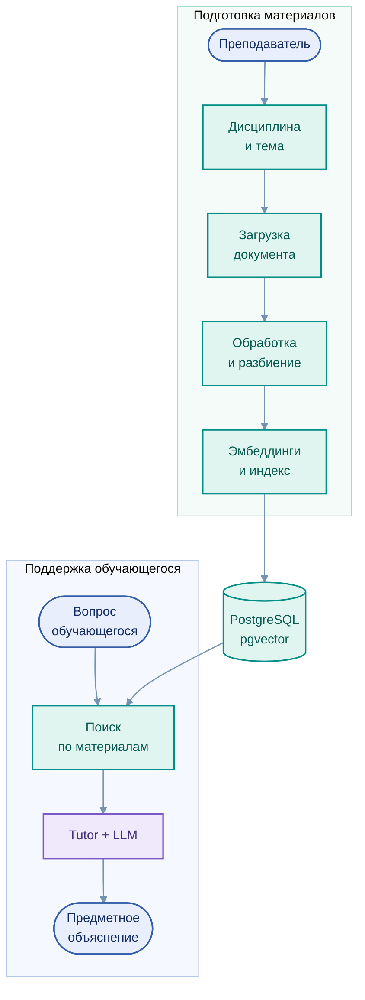
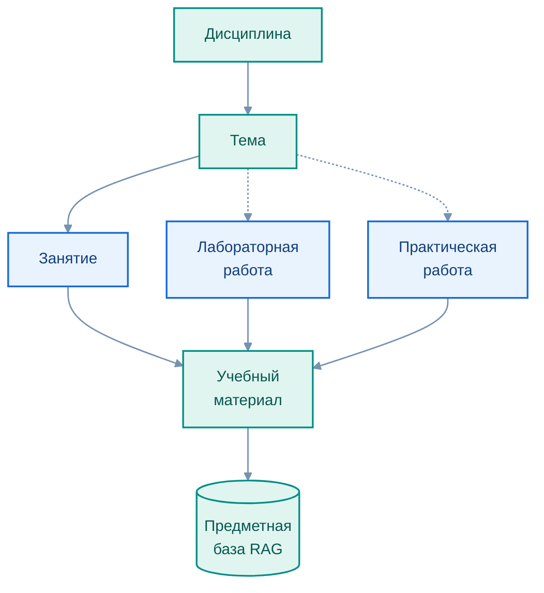

# Предметная база знаний и поиск RAG

[← Архитектура](01_overview.md) · [EduRAG Loader](../services/edurag_loader/README.md)

Retrieval-Augmented Generation (RAG) используется для включения в ответ материалов соответствующей дисциплины. Это позволяет связывать пояснения с учебным контекстом: темой занятия, заданием, терминологией и методическими требованиями преподавателя.

## Подготовка материалов и формирование ответа

Редактируемая диаграмма: [`rag_pipeline.mmd`](../assets/rag_pipeline.mmd)

**Материалы дисциплины** организуются в каталоге, обрабатываются и подготавливаются для поиска. **Запрос обучающегося** сопоставляется с доступным предметным контекстом, после чего языковая модель формирует пояснение.

Важно различать загрузку файла и появление его фрагментов в поисковом индексе. Подготовка, подтверждение и индексация — разные операции; их согласованность в полном цикле продолжает развиваться.

## Информационная модель

Редактируемая диаграмма: [`course_structure.mmd`](../assets/course_structure.mmd)

| Элемент | Назначение |
|---|---|
| **Дисциплина** | Область учебных знаний |
| **Тема** | Логический раздел содержания |
| **Занятие** | Форма учебной деятельности |
| **Материал** | Документ, Notebook, условие работы, критерии, пример или методический текст |
| **Поисковый индекс** | Фрагменты, метаданные и векторные представления |

## Технологии

     

В качестве основы предметного поиска используются PostgreSQL и pgvector; эмбеддинги формируются средствами соответствующей модели, а генерация пояснений выполняется локальной LLM. Структурно-семантические методы поиска развиваются в рамках согласования Loader и Tutor.

[Управление материалами](../services/edurag_loader/README.md) · [Образовательные треки](../education/03_courses.md)
