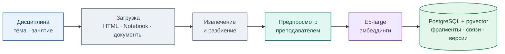
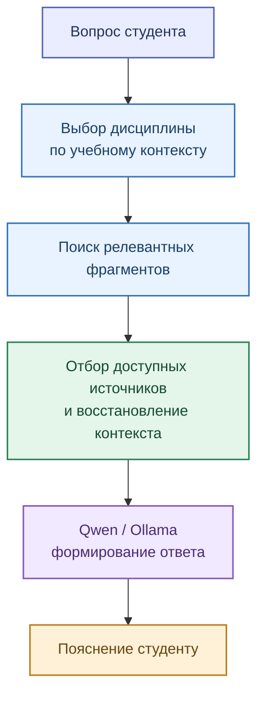

# База знаний и поиск RAG

[← Архитектура](01_overview.md) · [EduRAG Loader](../services/edurag_loader/README.md)

EduRAG Loader создаёт базу знаний на основе материалов преподавателя. EduTutor извлекает относящиеся к вопросу фрагменты и использует их как контекст для локальной языковой модели.

## Подготовка материалов

Для хранения контекста используется ключ дисциплины `rag_key`. Учитываются учебная иерархия, принадлежность фрагментов документам и активности, а также связи дочерних фрагментов с исходными разделами (Parent–Child).

## Получение контекста для ответа

### Поиск в EduRAG Loader и EduTutor

В диагностическом поиске Loader реализован `hybrid_v1`: предварительный векторный поиск, после которого кандидаты ранжируются по семантическому, лексическому и структурному соответствию. **Это функция Loader**, а не подтверждённая функция действующего EduTutor.

В EduTutor ранее применялся отдельный семантический поиск. Совместное использование `hybrid_v1`, точная привязка задания и отображение источников в ответе — следующие задачи интеграции.

**Ограничение:** релевантность фрагмента сама по себе ещё не гарантирует полноту или безошибочность итогового ответа. Поддержка должна опираться на доступный студенту материал и не раскрывать преподавательские решения.
