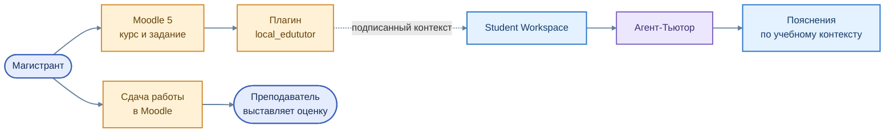

# Интеграция с Moodle 5

[← Архитектура](01_overview.md) · [Учебный маршрут](../education/01_student_path.md)

Moodle остаётся базовой системой организации учебного процесса: в LMS размещены дисциплины, задания, сроки, отправленные работы и оценки. EduTutor подключается как **интеллектуальное сопровождение**, не заменяя эти функции.

**Цветная схема связи Moodle и EduTutor**

Исходник схемы: [`moodle_context.mmd`](../assets/moodle_context.mmd)

## Путь пользователя

1. Магистрант открывает учебное задание в Moodle.
2. Плагин `local_edututor` предусматривает передачу подписанного контекста курса и задания.
3. Student Workspace показывает интерфейс диалога с Тьютором.
4. Tutor помогает разобраться в условии и материалах дисциплины.
5. Работа направляется на оценивание средствами Moodle и преподавателя.

## Контекст обучения

Особенно важны устойчивые идентификаторы **курса, учебной активности и задания**. Они позволяют связывать вопрос студента с подходящими материалами RAG. Уточнение индивидуального варианта и исходного документа является направлением дальнейшей интеграции.

Плагин реализует механизм подписанного запуска, однако это не следует трактовать как утверждение, что **любой пользовательский маршрут во всех окружениях уже полностью интегрирован**.

## Разделение ответственности

| Moodle | EduTutor |
|---|---|
| Выдача и сдача задания | Предметная помощь при его выполнении |
| Учёт обучающихся и работ | Использование контекста курса |
| Итоговые оценки преподавателя | Пояснения, черновые замечания, поиск материалов |

Автоматическая публикация оценок из Агента-Ассистента в журнал Moodle здесь не заявляется.

[Плагин Moodle](../services/moodle_edututor/README.md) · [Контроль информации](05_security.md)
