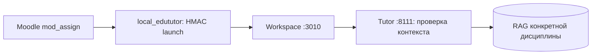

# Интеграция с Moodle 5

[← Архитектура](01_overview.md) · [Плагин](../services/moodle_edututor/README.md)

Moodle остаётся системой выдачи/сдачи заданий, а EduTutor — отдельным помощником. Зеркало плагина `local_edututor` и серверные маршруты для подписанного запуска присутствуют в прототипе.

Контекст включает сведения о дисциплине и задании; сервер обязан проверить подлинность подписи, срок действия и допустимость доступа. Наличие API-маршрутов и кода HMAC-проверки **не равно успешному полному тесту с реальной сессией Moodle**.

**Состояние на 25.10.2026:** маршруты присутствуют и студенческий Tutor/RAG проверен, но **live Moodle HMAC E2E — NOT_VERIFIED**. Сценарии скачивания материалов через доверенную сессию также требуют отдельного подтверждения. Плагин не записывает оценки в журнал Moodle.

**В развитии:** устойчивое сопоставление задания Moodle с учебной активностью RAG и индивидуальным вариантом студента, управление версиями источников, защищённый преподавательский запуск (не готовый `/teacher`).
