# Связь с Moodle 5

[← Архитектура](01_overview.md) · [Описание плагина](../services/moodle_edututor/README.md)

Отдельный плагин `local_edututor` связывает **страницу задания Moodle** с пользовательским интерфейсом EduTutor. Это позволяет обращаться за помощью в контексте учебной работы.

## Сценарий запуска

```mermaid
flowchart LR
    S["Студент"] --> M["Moodle 5<br/>задание mod_assign"]
    M --> P["local_edututor<br/>подписанный запуск HMAC"]
    P --> V["EduTutor<br/>проверка контекста"]
    V --> A["Агент-Тьютор"]
    A --> K[("База знаний<br/>нужной дисциплины")]
    classDef student fill:#E9EDFF,stroke:#5666B9,color:#23315D,stroke-width:1.6px;
    classDef teacher fill:#E2F6F2,stroke:#14827A,color:#14524F,stroke-width:1.6px;
    classDef learning fill:#E9F2FF,stroke:#3575B9,color:#173F68,stroke-width:1.6px;
    classDef moodle fill:#FFF1D8,stroke:#BC7B18,color:#664510,stroke-width:1.6px;
    classDef ai fill:#F0E9FF,stroke:#8356BD,color:#4B2B73,stroke-width:1.6px;
    classDef knowledge fill:#E4F5E9,stroke:#288456,color:#154A32,stroke-width:1.6px;
    classDef tech fill:#EDF1F5,stroke:#64768A,color:#35465C,stroke-width:1.5px;
    classDef guard fill:#FFF0EA,stroke:#C2644D,color:#713A2E,stroke-width:1.6px;
    class S student;
    class M,P moodle;
    class V,A ai;
    class K knowledge;
```

### Что относится к действующему сценарию

Плагин передаёт контекст запуска, включающий сведения о пользователе, курсе и задании. EduTutor проверяет подпись и использует информацию для открытия помощника. **Плагин не записывает оценки в Moodle.**

### Что требуется для более точных ответов

| Данные | Польза для студента |
|---|---|
| Устойчивый идентификатор задания (`cmid`, `assign_id`) | Помощник различает одноимённые ПР/ЛР |
| `rag_key`, идентификатор активности Loader | Материалы извлекаются из правильного занятия |
| Индивидуальный вариант | Требования одного студента не смешиваются с другими |
| Версия и расположение источника | Можно проверить, откуда взято условие или пояснение |

Расширенный контракт описывает **планируемую совместимость**, а не подтверждённую передачу всех перечисленных полей на текущем стенде. На стороне EduTutor должны применяться проверки полномочий независимо от наличия HMAC-подписи.
