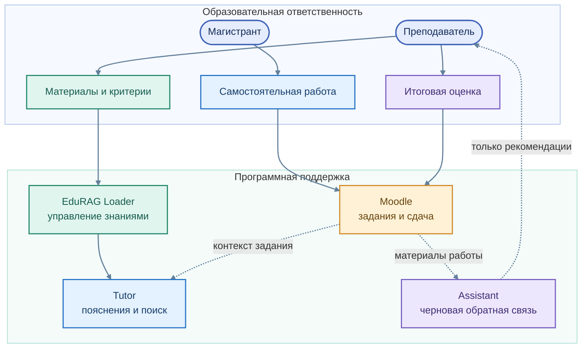

# Ответственность, данные и безопасное использование

[← Архитектура](01_overview.md) · [Маршрут преподавателя](../education/02_teacher_path.md)

EduTutor предназначен для образовательного взаимодействия, где **автоматизированная помощь не подменяет профессиональное решение преподавателя**. Публичное описание архитектуры не раскрывает закрытые конфигурации и учебные результаты отдельных студентов.

**Цветная схема границ ответственности**

Исходник схемы: [`responsibility_boundaries.mmd`](../assets/responsibility_boundaries.mmd)

## Принципы

**Предметная ограниченность.** Объяснения формируются с учётом доступных материалов соответствующей дисциплины; наличие языковой модели не гарантирует безошибочность каждого ответа.

**Преподавательский контроль.** Учебный контент публикуется после проверки. Черновой анализ работы является вспомогательным, а итоговое решение об оценивании остаётся за человеком.

**Разделение ролей сервисов.** Moodle управляет заданиями, EduRAG Loader — учебными материалами, Tutor — сопровождением вопросов, Orchestrator — координацией специализированных функций.

**Минимизация раскрытия.** Публичный репозиторий содержит архитектурные описания и методические сценарии, но не учётные данные, рабочие конфигурации, внутренние адреса, закрытые решения и персональные данные.

## Какие материалы подходят для учебной базы

| Допустимый тип | Не предназначено для студенческого поиска |
|---|---|
| Условия заданий, лекционные материалы, общие примеры | Эталонные решения закрытых заданий |
| Методические рекомендации и определения | Персональные сведения обучающихся |
| Проверенные источники для самостоятельного изучения | Секреты, токены, технические журналы |

Безопасное отказоустойчивое поведение и Human-in-the-loop входят в архитектурные принципы системы. Полнота этих механизмов оценивается отдельно от их описания.

[EduTutor](../services/edututor/README.md) · [Moodle](04_moodle.md)
