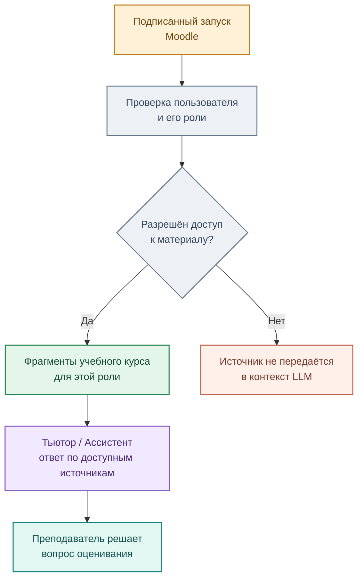

# Доступ к учебной информации и контроль качества

[← Архитектура](01_overview.md) · [Образовательный маршрут](../education/01_student_path.md)

При работе со студенческими заданиями необходимо разделять **доступные материалы**, **закрытые преподавательские эталоны** и **данные обучающихся**. Подпись запуска Moodle подтверждает происхождение контекста, но не заменяет проверку прав на конкретные документы.

## Границы доступа

Принципы продукта: не публиковать закрытые решения студентов и преподавателей; ограничивать поиск по полномочиям; не записывать оценки без явного решения преподавателя; сохранять сведения об использованных источниках и действиях для диагностики спорных случаев.

В архитектуре предусмотрена прослеживаемость действий агента. **Наличие схемы контроля не означает, что завершена сквозная проверка разграничения доступа во всех сервисах.**
