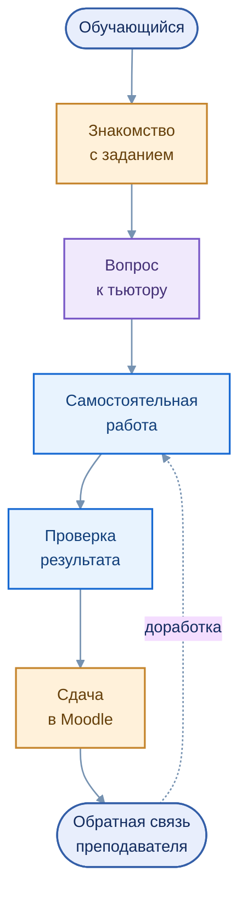

# Сценарий обучающегося

[← Образовательные сценарии](README.md) · [Tutor](../services/edututor/README.md)

EduTutor сопровождает обучающегося во время выполнения задания: помогает разобраться в постановке задачи, подобрать метод решения, найти ошибку и объяснить полученный результат. Сценарий применим к различным образовательным программам и уровням подготовки.

## Маршрут работы

Редактируемая диаграмма: [`learning_journey.mmd`](../assets/learning_journey.mmd)

| Этап | Действия обучающегося | Роль EduTutor |
|---|---|---|
| Постановка задачи | Изучает условие и критерии | Уточняет термины и ограничения |
| Планирование | Выбирает способ решения | Объясняет методы и возможные шаги |
| Выполнение | Работает с данными или кодом | Помогает разбирать ошибки и понятия |
| Анализ | Проверяет выводы и оформление | Даёт пояснения с опорой на доступный контекст |
| Завершение | Передаёт результат преподавателю | Не подменяет итоговую оценку |

## Примеры по образовательным трекам

В бизнес-информатике это может быть анализ наборов данных, в педагогическом образовании — изучение цифровых учебных практик, в робототехнике — обработка телеметрии, в программировании — разбор алгоритма, в информационной безопасности — анализ учебного технического случая.

**Примеры иллюстрируют масштабируемость сценария**, а не утверждают, что каждый из них уже внедрён в учебный процесс.

[Образовательные треки](03_courses.md) · [Интеграция с Moodle](../architecture/04_moodle.md)
