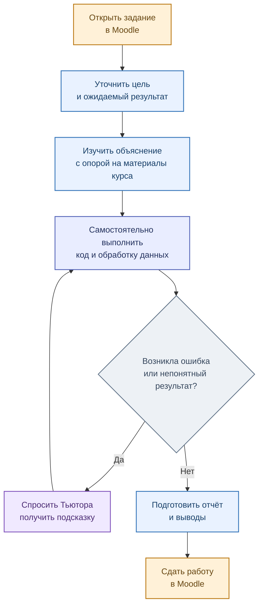

# Маршрут студента

[← Главная](../README.md) · [Дисциплины](03_courses.md) · [Возможности Тьютора](../services/edututor/README.md)

EduTutor сопровождает магистранта **от знакомства с заданием до самостоятельной проверки результата**. Основной источник требований — материалы преподавателя в Moodle и базе знаний дисциплины.

## Как студент использует помощника

### Какие вопросы уместны

| На этапе | Пример вопроса |
|---|---|
| Понимание условия | «Какие этапы включает практическая работа?» |
| Сбор данных | «Как правильно обработать ошибки и ограничение запросов REST API?» |
| Очистка | «Почему регулярное выражение неверно выделяет число с суффиксом K?» |
| Анализ | «Как интерпретировать диаграмму и проверить вывод по данным?» |
| Самопроверка | «Какие требования обязательны именно для моего варианта?» |

**Граница помощи:** система объясняет и направляет, но не подменяет авторскую работу студента. Если подтверждённого ответа в материалах нет, помощник должен обозначить неопределённость, а не придумывать требования.

**Точность контекста:** дисциплина определяется по `rag_key`; уточнение конкретного задания, варианта и версии документа требует развития сквозной интеграции Moodle–EduTutor–Loader. Поэтому при необходимости студенту важно указывать номер варианта в вопросе.

[Как преподаватель готовит материалы →](02_teacher_path.md)
