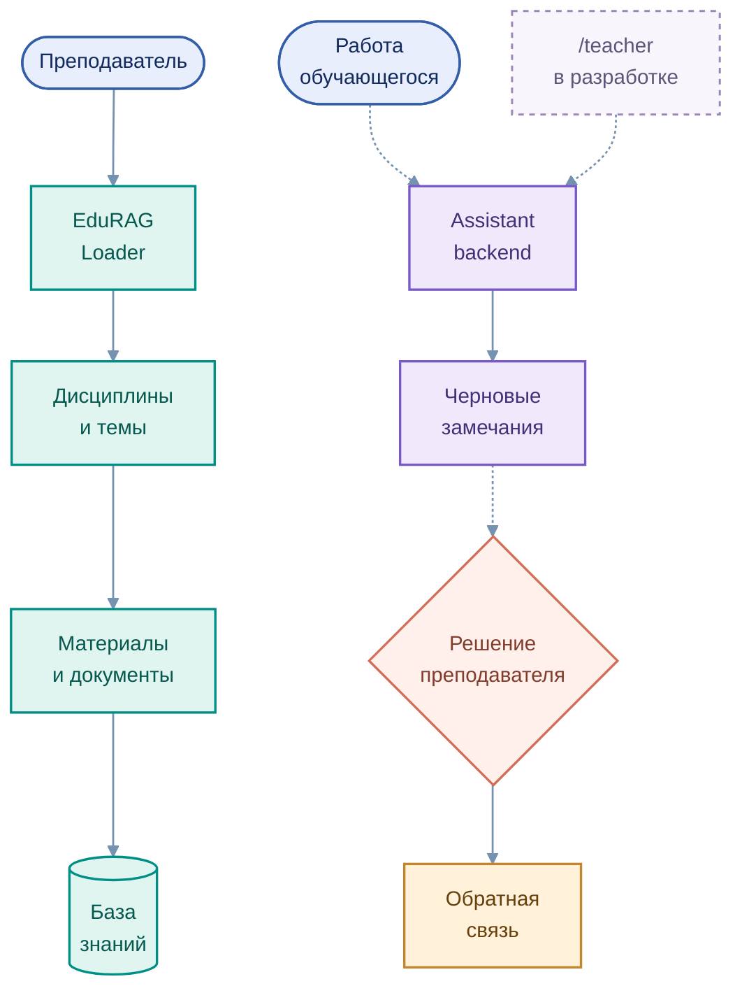

# Сценарий преподавателя

[← Образовательные сценарии](README.md) · [EduRAG Loader](../services/edurag_loader/README.md)

Преподаватель задаёт учебную структуру дисциплины, готовит материалы и критерии оценивания. EduTutor предоставляет инструменты для организации базы знаний и предусматривает интеллектуальную поддержку подготовки обратной связи.

## Организация учебного процесса

Редактируемая диаграмма: [`teacher_workflow.mmd`](../assets/teacher_workflow.mmd)

| Этап | Роль преподавателя | Поддержка системы |
|---|---|---|
| Подготовка дисциплины | Формирует темы и учебные активности | EduRAG Loader организует каталог |
| Публикация материалов | Загружает документы и задания | Обработка материалов для предметного поиска |
| Сопровождение | Анализирует типичные затруднения | Tutor поясняет учебные вопросы |
| Проверка работ | Оценивает результат по критериям | Assistant backend может подготовить черновые замечания |
| Итоговое решение | Утверждает обратную связь и оценку | Moodle остаётся системой учёта результатов |

Существование Assistant backend не означает завершения отдельного интерфейса преподавателя или автоматического присвоения оценок. **Human-in-the-loop — архитектурный принцип сохранения человеческого решения**, который развивается последовательно.

[Схема ответственности](../architecture/05_security.md) · [Структура базы знаний](../architecture/03_rag.md)
