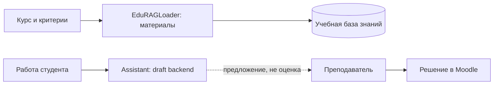

# Маршрут преподавателя

[← Главная](../README.md) · [EduRAGLoader](../services/edurag_loader/README.md)

Преподаватель задаёт содержание и критерии обучения, формирует учебные материалы и принимает **окончательное решение об оценке**. Тьютор ориентирован на работу студента, а Ассистент предназначен для подготовки предварительных замечаний.

**Различать текущую реализацию и цель:** каталог и read-only просмотр Loader проверены; Assistant способен сформировать черновик в companion-тесте. Полный преподавательский интерфейс `/teacher`, серверные права и подтверждение HITL **ещё не реализованы как завершённый E2E**. Автоматической записи оценок в Moodle нет.

Для студенческого RAG не должны использоваться закрытые эталонные решения, данные других обучающихся и непроверенные источники. [Безопасность](../architecture/05_security.md).
