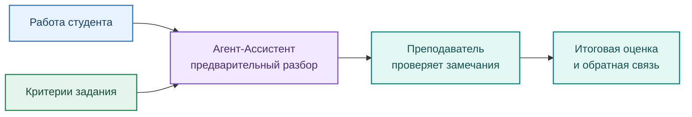

# Маршрут преподавателя

[← Главная](../README.md) · [EduRAG Loader](../services/edurag_loader/README.md)

Преподаватель управляет **содержанием** учебной поддержки: формирует задания и критерии, организует материалы дисциплины и определяет допустимый объём помощи. EduTutor не заменяет преподавательское оценивание.

## Подготовка учебной базы знаний

```mermaid
flowchart LR
    A["Дисциплина<br/>и программа"] --> B["Темы и занятия<br/>ПР / ЛР / лекции"]
    B --> C["Материалы<br/>условие / Notebook"]
    C --> D["Предпросмотр<br/>и проверка"]
    D --> E["Публикация<br/>в базе знаний"]
    E --> F["Проверка поиска<br/>контрольные вопросы"]
    F -. "при обновлении" .-> C
    classDef student fill:#E9EDFF,stroke:#5666B9,color:#23315D,stroke-width:1.6px;
    classDef teacher fill:#E2F6F2,stroke:#14827A,color:#14524F,stroke-width:1.6px;
    classDef learning fill:#E9F2FF,stroke:#3575B9,color:#173F68,stroke-width:1.6px;
    classDef moodle fill:#FFF1D8,stroke:#BC7B18,color:#664510,stroke-width:1.6px;
    classDef ai fill:#F0E9FF,stroke:#8356BD,color:#4B2B73,stroke-width:1.6px;
    classDef knowledge fill:#E4F5E9,stroke:#288456,color:#154A32,stroke-width:1.6px;
    classDef tech fill:#EDF1F5,stroke:#64768A,color:#35465C,stroke-width:1.5px;
    classDef guard fill:#FFF0EA,stroke:#C2644D,color:#713A2E,stroke-width:1.6px;
    class A,B teacher;
    class C,D learning;
    class E knowledge;
    class F ai;
```

Учебная иерархия в EduRAG Loader: **уровень образования → направление подготовки / специальность → программа → дисциплина → тема → занятие → материал**. Преподаватель публикует проверенные учебные материалы только после предпросмотра.

## Сопровождение студента и проверка

Преподаватель проверяет корректность комментариев и принимает итоговое решение (**Human-in-the-loop**). Автоматическая запись оценки в журнал Moodle текущим плагином не предусмотрена.

**Не индексировать для студентского доступа:** преподавательские эталонные решения, закрытые ответы, персональные данные обучающихся и непроверенные материалы.
