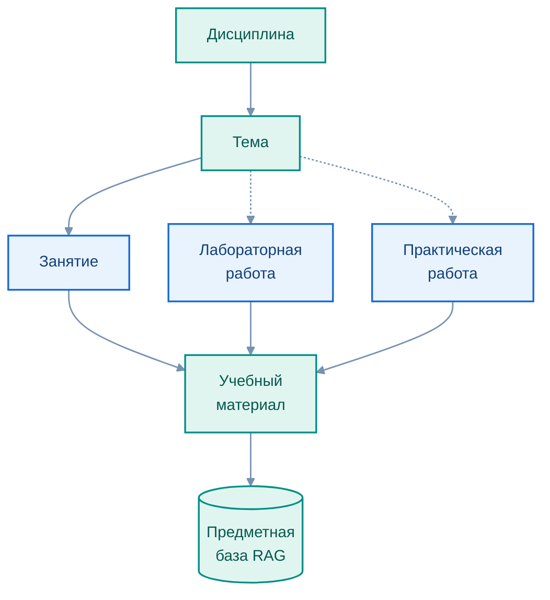

# Образовательные треки и дисциплины

[← Образовательные сценарии](README.md) · [EduTutor](../README.md)

EduTutor проектируется как **предметно адаптируемая образовательная платформа**. Основа масштабирования — учебные материалы и задания конкретной дисциплины, которые связываются с контекстом обращения обучающегося.

## Первоначальная предметная область

Грантовый проект исходно ориентирован на поддержку изучения анализа данных в магистратуре. В качестве стартовых дисциплин рассматриваются:

| Дисциплина | Учебные задачи |
|---|---|
| **Python для анализа данных** | Подготовка данных, визуализация, исследовательский анализ, интерпретация результатов |
| **Программные средства сбора, консолидации и аналитики данных** | API, веб-источники, очистка, объединение данных, аналитика и выводы |

**38.04.05 «Бизнес-информатика»** — первоначальная образовательная область, но не функциональное ограничение продукта.

## Направления развития

| Образовательный трек | Возможные дисциплины и виды практики |
|---|---|
| Педагогическое образование | Цифровая педагогика, образовательная аналитика, ИИ в преподавании |
| Информатика и программная инженерия | Алгоритмы, Python, SQL, базы данных, программирование |
| Робототехника и интеллектуальные системы | IoT, телеметрия, потоки событий, обработка сенсорных данных |
| Машинное обучение и анализ данных | Подготовка датасетов, обучение и интерпретация моделей |
| Бизнес-информатика | Консолидация источников, аналитика, визуализация, поддержка решений |
| Информационная безопасность | Моделирование угроз, оценка рисков, разбор инцидентов |

Перечень отражает **возможные области применения**, включая педагогические и технические программы бакалавриата и магистратуры. Реализация конкретного учебного трека предполагает подготовку материалов, настройку контекста и отдельную педагогическую апробацию.

## Как подключается новая предметная область

Редактируемая диаграмма: [`course_structure.mmd`](../assets/course_structure.mmd)

Преподаватель определяет структуру дисциплины, подготавливает учебные документы и связывает их с занятиями. На этой основе формируется предметный контекст для интеллектуальной поддержки. Полный цикл публикации новых материалов в поисковый индекс требует согласованной обработки данных и продолжает совершенствоваться.

[EduRAG Loader](../services/edurag_loader/README.md) · [Предметный RAG](../architecture/03_rag.md)
