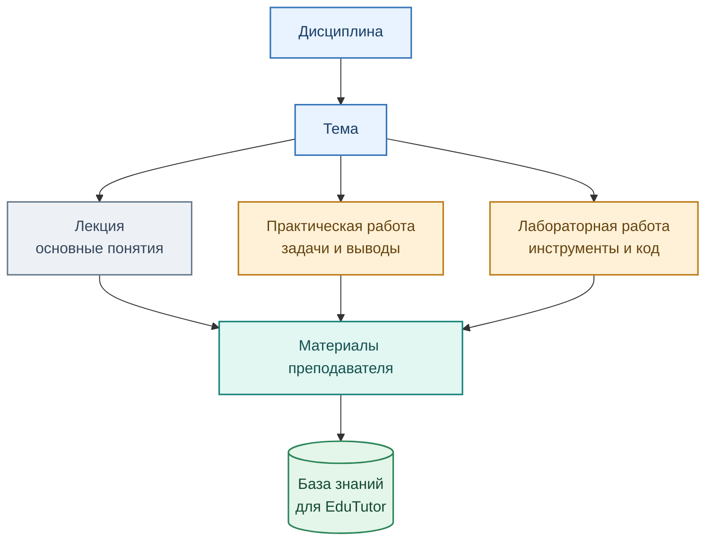

# Дисциплины и виды учебной деятельности

[← Главная](../README.md) · [Маршрут студента](01_student_path.md)

Продукт разрабатывается прежде всего для магистрантов направления **38.04.05 «Бизнес-информатика»**, профиль **«Бизнес-аналитика и большие данные»**.

## Дисциплины

| Дисциплина | Что осваивает обучающийся | Ключ базы знаний |
|---|---|---|
| **Python для анализа данных** | Python-инструменты подготовки, исследования и представления данных | `python_data_analysis` |
| **Программные средства сбора, консолидации и аналитики данных** | Получение данных из веб-источников и API, очистка, объединение, аналитика и подготовка обоснованных выводов | `data_collection_analytics` |

## Учебные активности

ПР и ЛР различаются **по назначению в учебном процессе**, хотя в Moodle обе могут оформляться элементом «Задание» (`mod_assign`). В системе учитываются название активности, материалы, критерии и связь с дисциплиной.

## Пример образовательного сценария

Для практической работы по открытым API, HTML и регулярным выражениям обучающийся проходит этапы: **REST API → HTML → очистка → анализ → выводы**. Тьютор помогает понять порядок выполнения, разобрать ошибки кода и сформулировать выводы по собранным данным. Конкретные показатели определяются индивидуальным вариантом и источником данных.

Вместо универсальной проверки «зарплаты и навыки извлечены» применяются только требования, относящиеся к источнику и варианту обучающегося. Для точного сопоставления вариантов во всех сервисах требуется развитие интеграции.

[Подробнее об устройстве учебной базы знаний →](../architecture/03_rag.md)
