# EduRAG Loader — управление учебной базой знаний

[← На главную](../../README.md) · [RAG-архитектура](../../architecture/03_rag.md)

**EduRAG Loader** — инструмент преподавателя для организации материалов дисциплин и подготовки предметной базы знаний, используемой интеллектуальными сервисами EduTutor.

**Цветная схема конвейера учебных материалов**

```mermaid
flowchart LR
    P(["Преподаватель"]) --> C["Дисциплина<br/>и темы"]
    C --> U["Загрузка<br/>учебного материала"]
    U --> PR["Обработка<br/>метаданных и текста"]
    PR --> CH["Фрагментация<br/>и эмбеддинги"]
    CH --> DB[("PostgreSQL<br/>+ pgvector")]
    Q(["Вопрос студента"]) --> S["Предметный поиск RAG"]
    DB --> S
    S --> A["Tutor + локальная LLM"]
    A --> F(["Объяснение<br/>в контексте курса"])
    class P,Q,F person;
    class C,U,PR,CH,S,DB data;
    class A agent;

classDef person fill:#E5ECFD,stroke:#4164B9,color:#142C59,stroke-width:2px;
classDef lms fill:#FFF1D6,stroke:#D28A2B,color:#66440C,stroke-width:1.8px;
classDef ui fill:#E4F1FE,stroke:#2774C7,color:#153D6A,stroke-width:1.8px;
classDef agent fill:#EDE7FD,stroke:#7960C2,color:#3D2D73,stroke-width:1.8px;
classDef data fill:#E1F5EF,stroke:#268A6D,color:#155C4B,stroke-width:1.8px;
classDef infra fill:#EBEFF5,stroke:#6F8198,color:#35445A,stroke-width:1.8px;
classDef guard fill:#FFEBE8,stroke:#C76650,color:#7B3429,stroke-width:1.8px;
classDef future fill:#F4F2FB,stroke:#9D95BD,color:#55506E,stroke-width:1.5px,stroke-dasharray:5 4;
linkStyle default stroke:#63809B,stroke-width:1.8px;
```

Исходник схемы: [`rag_pipeline.mmd`](../../assets/rag_pipeline.mmd)

## Информационная модель

Учебный контент организуется в последовательности **дисциплина → тема → занятие → материал** с учётом уровня образования, направления подготовки и программы. Эта структура помогает находить сведения в правильном образовательном контексте.

## Предметные возможности

| Направление | Для чего используется |
|---|---|
| Каталог дисциплин | Организация курса и его учебной структуры |
| Темы и занятия | Связь материала с образовательной активностью |
| Документы и Notebook | Подготовка текстового содержания и исходников для поиска |
| Обработка и фрагментация | Формирование частей учебного документа и метаданных |
| Векторный индекс | Поиск материалов с помощью PostgreSQL/pgvector |
| Диагностический поиск | Просмотр релевантных фрагментов и проверка контекста |

Управление дисциплинами и темами, просмотр и обновление материалов доступны в штатном режиме управления. Диагностический режим просмотра используется отдельно. Публичная документация описывает назначение продукта, а не внутренние инструкции администрирования и права на рабочую БД.

Цепочка публикации нового документа в поисковый индекс включает отдельные этапы обработки, подтверждения и построения эмбеддингов; её нельзя отождествлять с простым фактом загрузки файла. В архитектуре предусмотрены элементы структурно-семантического поиска; согласованное использование соответствующих механизмов во всех агентах развивается постепенно.

[Роль преподавателя](../../education/02_teacher_path.md) · [Устройство RAG](../../architecture/03_rag.md)
