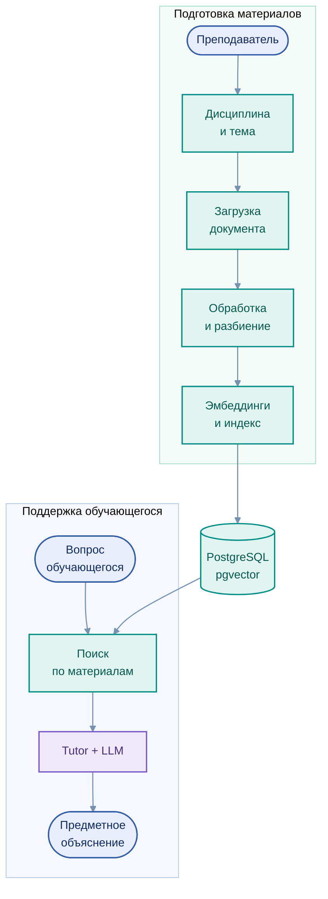

# EduRAG Loader — управление учебной базой знаний

[← EduTutor](../../README.md) · [Предметный RAG](../../architecture/03_rag.md)

EduRAG Loader — компонент для организации предметных материалов образовательных программ. Он позволяет преподавателю управлять структурой дисциплин, тем и учебных документов и подготавливать содержание к использованию в поисковых сценариях EduTutor.

## Информационный поток

Редактируемая диаграмма: [`rag_pipeline.mmd`](../../assets/rag_pipeline.mmd)

## Возможности

| Направление | Назначение |
|---|---|
| Каталог | Создание и изменение дисциплин и тем |
| Учебные материалы | Загрузка, просмотр и управление документами |
| Обработка | Выделение текста, фрагментация, формирование эмбеддингов |
| Поиск | Работа с предметными индексами и диагностикой релевантности |
| Управление | Исправление и удаление отдельных объектов каталога |

В приложении предусмотрен рабочий режим управления материалами; отдельный режим просмотра используется для диагностики. **Загрузка документа и завершение его индексации — разные стадии**, поэтому наличие записи о загрузке само по себе не означает готовность материала к поиску.

## Технологии

     

[Модель учебного контента](../../architecture/03_rag.md) · [Роль преподавателя](../../education/02_teacher_path.md)
