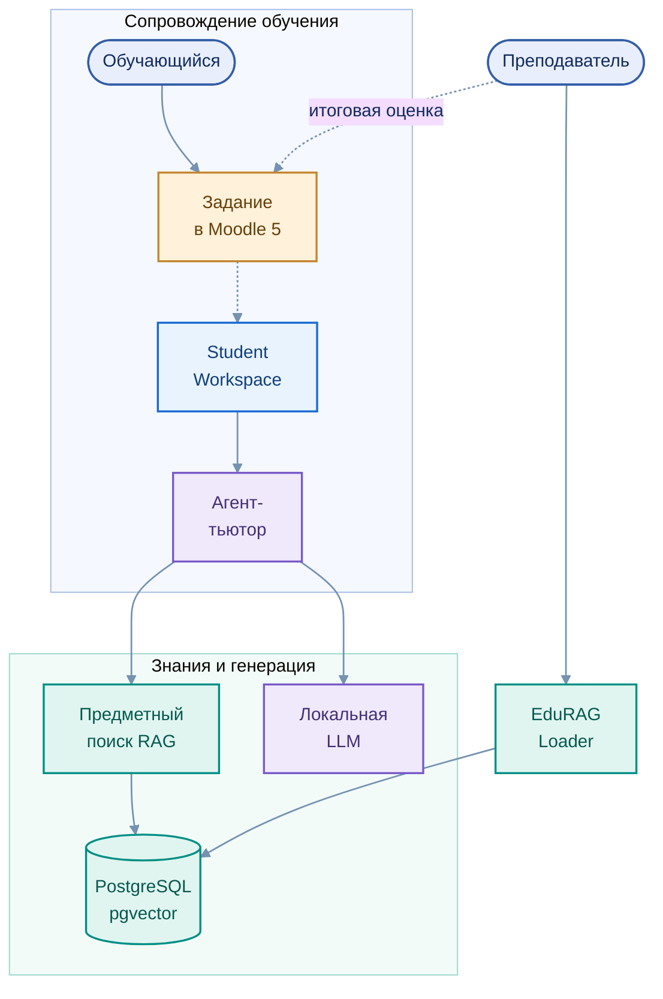

# EduTutor — интеллектуальная поддержка обучающегося

[← EduTutor](../../README.md) · [Архитектура](../../architecture/01_overview.md)

Агент-тьютор предназначен для предметных пояснений во время самостоятельной учебной деятельности. Его архитектура соединяет пользовательский интерфейс, серверную обработку, поиск по материалам дисциплины и локальную языковую модель.

## Взаимодействие компонентов

Редактируемая диаграмма: [`edututor_overview.mmd`](../../assets/edututor_overview.mmd)

## Основные задачи

- Объяснение формулировок учебного задания и терминологии дисциплины.
- Поддержка работы с Python, SQL, алгоритмами и данными в предусмотренных сценариях.
- Анализ типичных ошибок и пояснение подходов к их исправлению.
- Использование предметного контекста RAG при формировании ответа.
- Содействие самостоятельной интерпретации и проверке результатов.

Тьютор является **помощником в обучении**, а не системой автоматического выставления оценок. Связь с заданиями Moodle, конкретными вариантами и первоисточниками развивается поэтапно.

## Программная основа

       

[Образовательный маршрут](../../education/01_student_path.md) · [Агенты](../../architecture/02_agents.md) · [Технологии](../../architecture/06_technology_stack.md)
