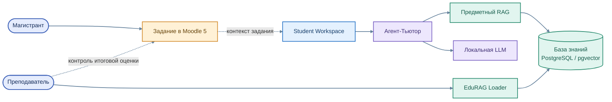

# EduTutor — интеллектуальный помощник

[← На главную](../../README.md) · [Общая архитектура](../../architecture/01_overview.md)

**EduTutor** помогает магистранту изучать анализ данных на практике. Его основа — Student Workspace, Агент-Тьютор, поиск RAG и локальная языковая модель.

**Цветная архитектура EduTutor**

Исходник схемы: [`edututor_overview.mmd`](../../assets/edututor_overview.mmd)

## Агент-Тьютор: сопровождение студента

- Разъяснение формулировок учебного задания и технических терминов.
- Пояснение методов обработки, анализа и консолидации данных.
- Помощь в чтении Python-кода и поиске причин ошибок.
- Использование учебного материала дисциплины для предметного контекста.
- Поддержка интерпретации результатов без подмены самостоятельной работы.

## Интеллектуальные компоненты

| Компонент | Назначение |
|---|---|
| **Workspace** | Пользовательский интерфейс и учебный диалог |
| **Tutor** | Объяснения и предметный поиск |
| **Orchestrator** | Маршрутизация задач исследовательского многоагентного контура |
| **Assistant backend** | Черновые замечания по работе для преподавателя |
| **MCP** | Доступ к специализированным инструментам |
| **Ollama / Qwen** | Генерация ответов локальной языковой моделью |

## Актуальное направление развития

Приоритетом остаётся согласование задания Moodle, учебной активности EduRAG Loader и найденного первоисточника. Преподавательский интерфейс и полный цикл Human-in-the-loop рассматриваются отдельно от действующего студенческого сервиса.

**Итоговую оценку выставляет преподаватель.**

[Агенты](../../architecture/02_agents.md) · [RAG](../../architecture/03_rag.md) · [Студент](../../education/01_student_path.md)
