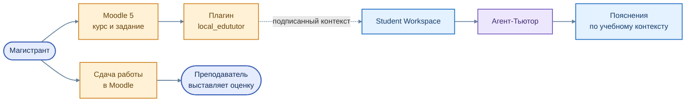

# Moodle `local_edututor` — связь задания и помощника

[← На главную](../../README.md) · [Интеграция Moodle](../../architecture/04_moodle.md)

Плагин **`local_edututor`** предназначен для перехода из Moodle 5 к EduTutor в контексте конкретного курса и учебного задания.

**Цветная схема интеграции Moodle**

Исходник схемы: [`moodle_context.mmd`](../../assets/moodle_context.mmd)

## Что делает интеграция

- Предусматривает подписанный контекст запуска для связи LMS с интерфейсом помощника.
- Позволяет учитывать учебный курс и задание при обращении к EduTutor.
- Сохраняет Moodle основным инструментом выдачи, сдачи и итогового оценивания работ.

## Что остаётся в развитии

Более точное сопоставление индивидуального варианта, версии исходного материала и учебной активности требует согласованной работы Moodle, Tutor и EduRAG Loader. Полный преподавательский интерфейс и автоматическая публикация оценки не относятся к действующим возможностям плагина.

[Образовательный маршрут](../../education/01_student_path.md) · [Архитектура](../../architecture/01_overview.md)
