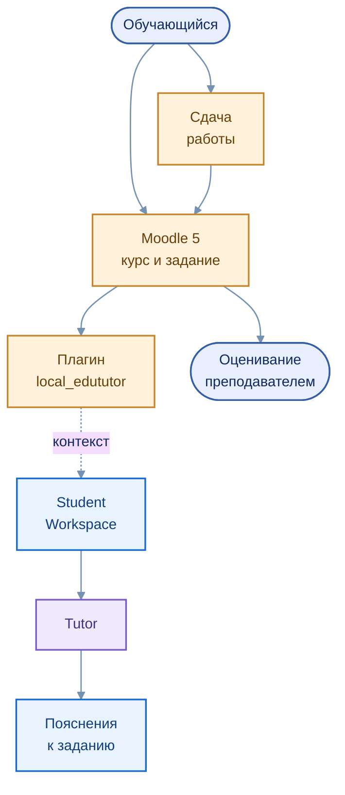

# Moodle `local_edututor` — интеграция учебного задания

[← EduTutor](../../README.md) · [Архитектура интеграции](../../architecture/04_moodle.md)

Интеграционный компонент `local_edututor` предназначен для перехода из Moodle 5 к интеллектуальному помощнику с учётом контекста курса и учебного задания. Moodle остаётся основной системой организации учебной активности и фиксации результатов.

## Схема взаимодействия

Редактируемая диаграмма: [`moodle_context.mmd`](../../assets/moodle_context.mmd)

## Назначение

- Передача необходимых сведений о курсе и задании в интерфейс EduTutor.
- Использование подписанного контекста для обращения к интеллектуальному помощнику.
- Сохранение процессов сдачи работ и итогового оценивания в Moodle.
- Подготовка к более точному сопоставлению учебных материалов, индивидуальных вариантов и исходных документов.

Функциональность преподавательского интерфейса и автоматической публикации оценок не относится к подтверждённым возможностям текущего плагина. Сквозная интеграция разворачивается последовательно и зависит от конфигурации образовательной среды.

## Технологии

  

[Образовательные сценарии](../../education/README.md) · [Ответственность компонентов](../../architecture/05_security.md)
