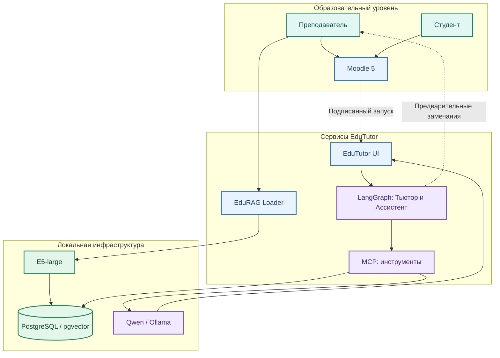
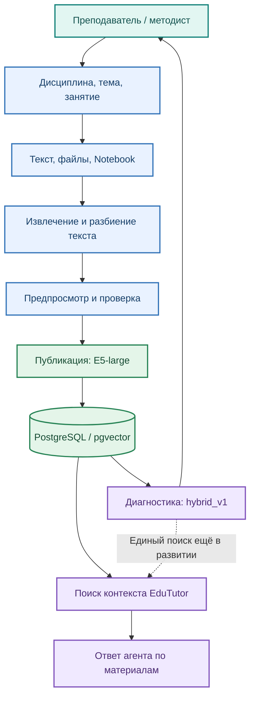
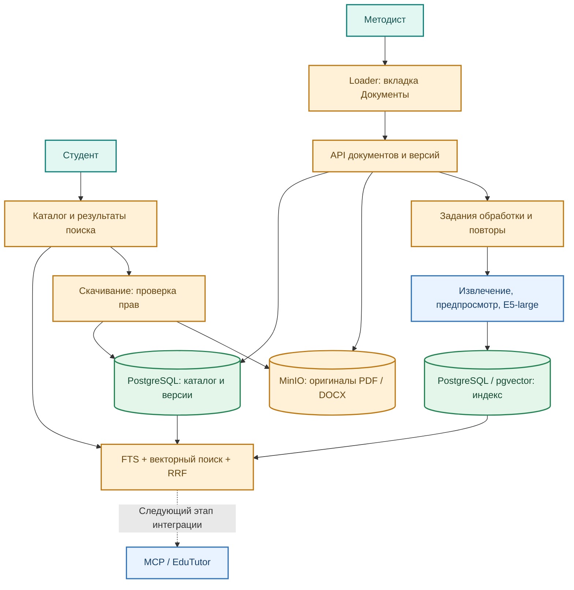
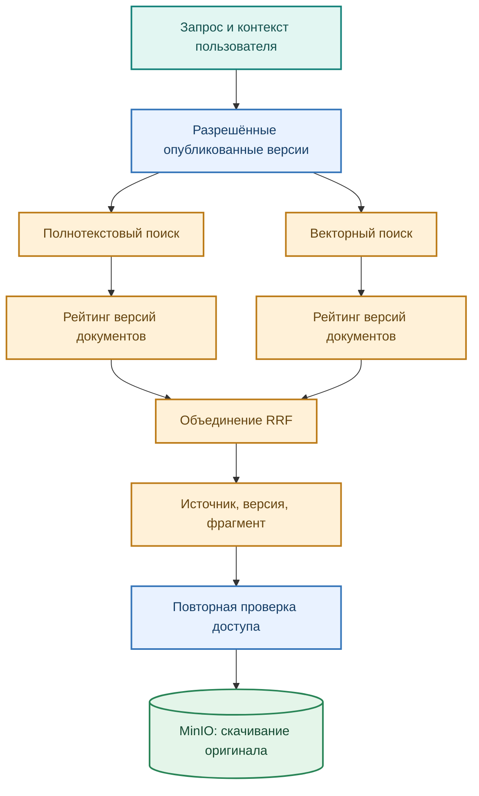

# Архитектура EduTutor и расширение Loader

Текущее состояние основано на документации main; оранжевый цвет в проектных схемах показывает доработки студента.

## Место конференционного исследования в архитектуре ВКР

Конференционный доклад **«Организация информационного обеспечения RAG-систем»** выделяет архитектурный аспект общего проекта: согласованное использование поисковых фрагментов и исходных документов, идентификацию конкретной версии оригинала и контролируемую выдачу первоисточника. Его два чёрно-белых рисунка иллюстрируют (1) подготовку контекста и ответ в существующем EduTutor и (2) предлагаемое расширение хранения и получения оригиналов. Они **не заменяют** четыре более детальные проектные схемы настоящего пакета и **не требуют пересмотра** агентной архитектуры.

Соответствие схем: рисунок 1 конференционного доклада соотносится с приложениями А и Б ниже (исходная система); рисунок 2 — с частью приложения В (оригиналы, версии, API и доступ). Дополнительный объём ВКР показывают приложения В и Г: каталог документов, независимые полнотекстовая и векторная ветви, агрегация по версиям, RRF, эксплуатационные проверки и испытания.

**Граница внедрения:** хранение оригиналов, расширение метаданных и API проектируются внутри Loader; программное подключение нового поиска и карточек первоисточников к ответам EduTutor — отдельный этап, обозначаемый пунктиром. Обязательность или завершённость этой интеграции не следует выводить из рисунков доклада.

## Приложение А Общая архитектура EduTutor
Схема воспроизводит состав и основные связи из architecture/01_overview.md репозитория BosenkoTM/llm-data-analytics-tutor. Названия сокращены для печати. Под EduTutor как суперсервисом понимается совокупность Moodle-интеграции, пользовательского сервиса, агентов, Loader и локальной инфраструктуры.

Рисунок А.1 — Общая архитектура по актуальной документации проекта.
Moodle передаёт подписанный контекст запуска. EduTutor UI работает с LangGraph; инструменты подключены через MCP. Qwen/Ollama формирует пояснения. Loader подготавливает знания, E5-large создаёт эмбеддинги, PostgreSQL/pgvector хранит поисковую базу. Преподаватель принимает окончательное решение об оценке.
Цвета обозначают роли: бирюзовый — пользователи, синий — образовательные сервисы, зелёный — данные, фиолетовый — интеллектуальные компоненты. MinIO на текущей схеме не показан: он относится к предлагаемому расширению Loader.
Основание: README.md, architecture/01_overview.md и architecture/02_agents.md. Срез ветки main: 20b8fba9399d0f447f2648ef0ecfe8f6324acf3d, проверен 22.10.2026.

## Приложение Б Текущая архитектура Loader
Схема составлена по services/edurag_loader/README.md, architecture/03_rag.md и education/02_teacher_path.md. Она отражает опубликованную функциональную архитектуру, а не реконструкцию внутренних классов и таблиц.

Рисунок Б.1 — Текущие процессы EduRAG Loader и граница интеграции с Tutor.
Loader уже поддерживает структуру дисциплин и занятий, текстовые материалы, прикрепление файлов и Notebook, извлечение текста, предпросмотр, публикацию и диагностический поиск hybrid_v1. В базе знаний учитываются rag_key, принадлежность фрагментов документам и активностям, связи Parent–Child.
Пунктир обозначает незавершённую интеграцию общего поиска Loader и Tutor. Точное сопоставление задания и варианта, показ источников в ответе и сквозная проверка полномочий также отмечены в репозитории как направления развития.
В публичном описании не установлен полный жизненный цикл оригиналов в MinIO и их скачивания студентами. Поэтому эта функция задана как доработка; наличие частичной реализации проверяется на рабочем стенде до написания нового кода.

## Приложение В Проект обновлённого Loader
Архитектурный прототип расширяет существующую систему. Зелёные узлы PostgreSQL на рисунке — разные логические области одной существующей СУБД, а не два новых сервера. Оранжевые узлы обозначают область разработки или расширения студентом, синие — повторно используемые компоненты.

Рисунок В.1 — Проект интеграции MinIO и управления документами.
API сохраняет оригинал в MinIO, а карточку и версию — в PostgreSQL. Задания обработки обеспечивают повторный запуск и связь с существующим извлечением и векторизацией. Поиск возвращает document_id, version_id, сведения об источнике, фрагмент и адрес API скачивания. MinIO не выполняет полнотекстовый или векторный поиск.
Скачивание выполняется с повторной проверкой полномочий и выдаёт ту версию, к которой относится найденный фрагмент. Подключение нового поиска к MCP/Tutor показано пунктиром как следующий этап; изменение агентной архитектуры не является обязательной частью ВКР.

## Приложение Г Поиск и критерии приёмки

Рисунок Г.1 — Проект гибридной выдачи и перехода к оригиналу.
Обе ветки получают одинаковые ограничения по дисциплине, публикации и правам пользователя. После агрегации фрагментов на уровне версии документа RRF объединяет рейтинги. Указание версии сохраняется до скачивания. Правила доступа применяются до формирования выдачи и передачи контекста LLM.
| Проверка | Критерий приёмки |
|---|---|
| Оригинал | Скачанный файл совпадает с загруженным по SHA-256 |
| Версия | Новый файл не перезаписывает прежний; выдача указывает точную версию |
| Доступ | Чужие и закрытые материалы отсутствуют в каталоге, сниппетах и скачивании |
| Сбой | Ошибка обработки видна; повтор не создаёт дублей; оригинал сохранён |
| Поиск | Три режима проверены на одном корпусе и отложенной разметке |
| Интеграция | Используются существующие rag_key и идентификаторы активности |
| Самостоятельность | Перечислены собственные модули, заимствованные компоненты и изменения |
Готовность прототипа подтверждается демонстрацией и протоколом испытаний. Численные результаты качества и производительности заполняются после эксперимента, без заранее объявленного выигрыша.
