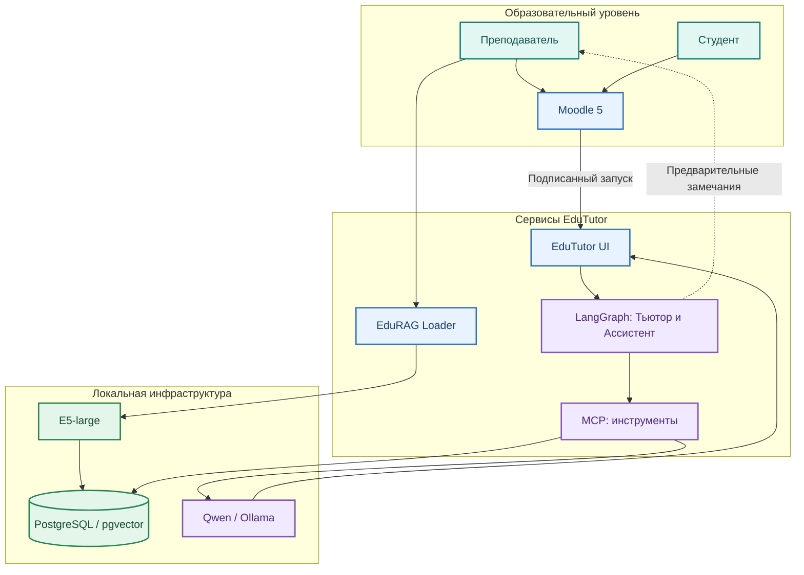
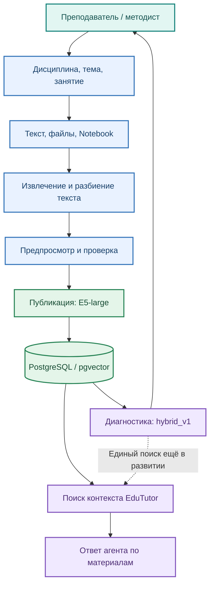
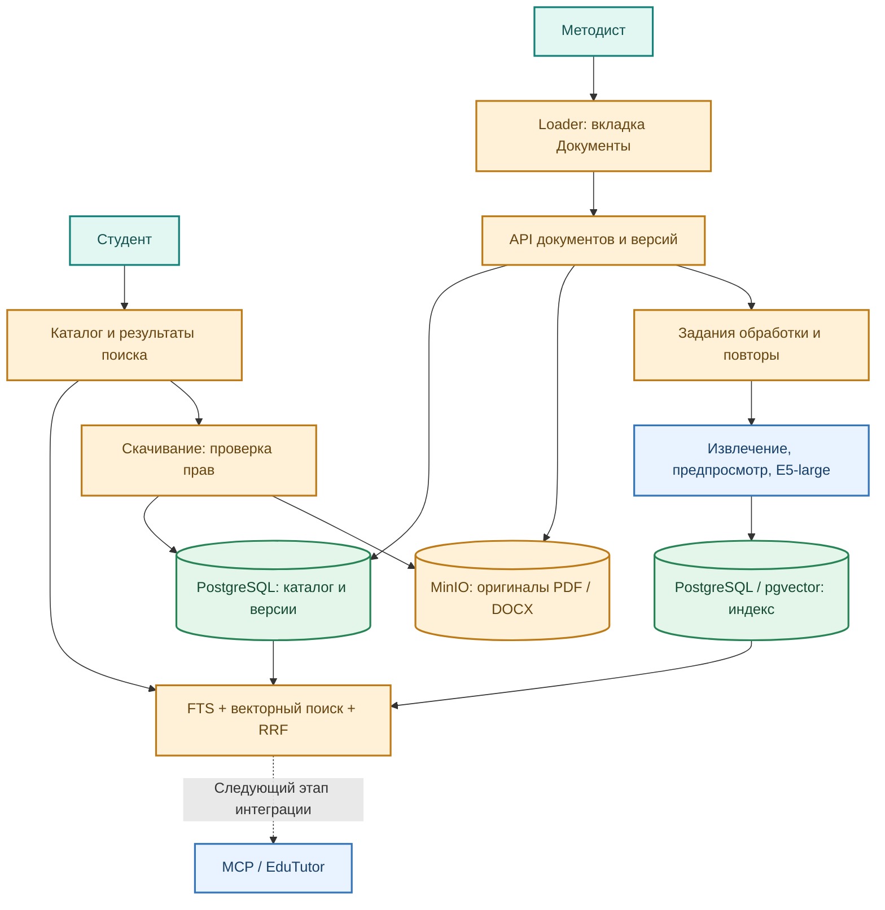
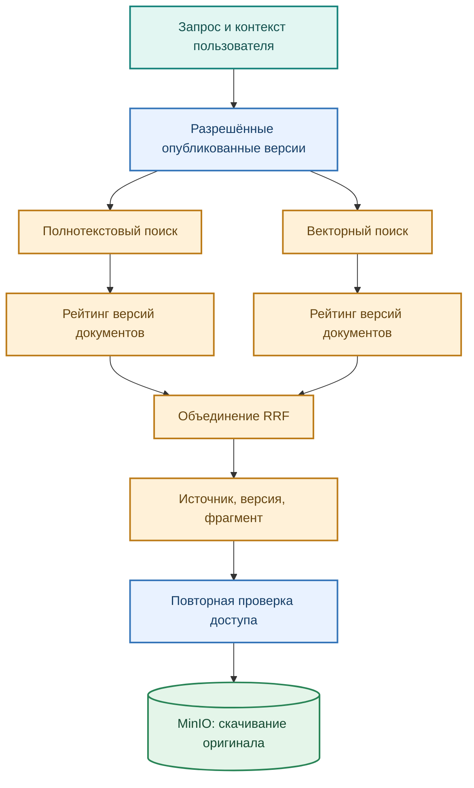

# Разработка программного сервиса интеграции и гибридного поиска научно-технической документации

Батраков С. А., БЭИ2301. Направление 09.03.03 «Прикладная информатика».
Научный руководитель: Босенко Т. М.

## 1 Актуальность
Научно-техническая документация включает статьи, технические руководства, описания программных средств и другие материалы, используемые в учебной и исследовательской работе. Пользователю необходимо находить сведения по точным терминам и по смыслу, а затем получать полный исходный документ с сохранёнными рисунками, таблицами и оформлением.
В существующем EduRAG Loader предусмотрены прикрепление материалов, извлечение текста, предпросмотр, публикация фрагментов и диагностический поиск hybrid_v1. Развитие сервиса в рамках ВКР связано с управлением оригиналами PDF/DOCX, их версиями и выдачей файлов по результатам гибридного поиска. Текстовые фрагменты и векторы не заменяют исходный файл.
PostgreSQL/pgvector сохраняется. MinIO добавляется как единственное отдельное хранилище оригиналов. MongoDB и GridFS в проект не включаются. Задача интеграции состоит в согласовании каталога, поискового индекса и файлов, а также в связи документа с дисциплиной и занятием.
## 2 Объект исследования
Информационные процессы загрузки, хранения, каталогизации, актуализации и поиска научно-технической документации в информационной системе научно-образовательной организации.
## 3 Предмет исследования
Модели данных и программные средства интеграции объектного хранилища оригиналов с каталогом и поисковой подсистемой PostgreSQL, методы гибридного ранжирования и механизмы связи найденных фрагментов с версиями документов.
## 4 Цель ВКР
Разработка программного сервиса интеграции и гибридного поиска научно-технической документации, обеспечивающего хранение оригиналов PDF/DOCX в MinIO, управление метаданными и версиями в PostgreSQL, поиск по словам и смыслу и скачивание найденных документов с учётом прав доступа.
Преимущество гибридного поиска проверяется экспериментально и не объявляется достигнутым до проведения испытаний. Образовательная система EduTutor выступает площадкой интеграции; утверждённая предметная область научно-технической документации сохраняется.

### Конференционное исследование как архитектурный этап ВКР

В рамках ВКР подготовлен конференционный доклад **«Организация информационного обеспечения RAG-систем»** (Батраков С. А.; научный руководитель Босенко Т. М.). Его предмет — организация совместной работы с фрагментированной базой знаний и полноценными исходными документами. На примере EduTutor рассмотрена действующая схема подготовки RAG-контекста и предложено расширение жизненного цикла документов: хранение оригиналов PDF/DOCX в объектном хранилище, ведение метаданных и версий в PostgreSQL, связывание поисковых фрагментов с точной версией файла и контролируемое предоставление первоисточника пользователю.

**Положение в общей работе:** результаты доклада используются для обоснования архитектуры хранения, модели идентификации версий и требований к выдаче оригиналов. ВКР шире конференционного исследования и включает программную реализацию названных функций, полнотекстовый, векторный и гибридный поиск на уровне документов, интеграционный API, интерфейс, обработку сбоев и экспериментальную оценку. Подготовка доклада не означает, что проектируемый сервис уже реализован или что результаты испытаний получены.

Планируемое включение в пояснительную записку: глава 1 — постановка проблемы и анализ RAG; глава 2 — архитектура информационного обеспечения и модель «фрагмент — версия — оригинал»; глава 3 — программная реализация сервиса и гибридного поиска; глава 4 — экспериментальная проверка целостности, доступности и релевантности. Тема ВКР и набор основных задач остаются прежними.

## 5 Основные задачи
1. Проанализировать архитектуру EduTutor и EduRAG Loader, определить существующие функции и самостоятельный вклад студента.
2. Описать процессы работы методиста и студента, сформировать функциональные требования и критерии приёмки.
3. Спроектировать интеграцию MinIO с существующим PostgreSQL, модель версий и связи с дисциплинами и занятиями.
4. Реализовать загрузку, проверку формата и размера, хранение, публикацию и скачивание оригиналов PDF/DOCX.
5. Расширить обработку материалов связью каждой поисковой записи с конкретной версией оригинала; использовать существующие средства извлечения и векторизации там, где они доступны.
6. Реализовать сравниваемые режимы полнотекстового, векторного и гибридного поиска с едиными правилами фильтрации и доступа.
7. Добавить вкладку «Документы», управление версиями и интеграционный API; обеспечить восстановление после ошибок обработки.
8. Провести функциональные испытания, сравнительные поисковые эксперименты и оценку трудозатрат пользователей.
## 6 Исходные данные
Корпус: 300–500 научно-технических документов из источников, допускающих выбранное использование. Для первоначального функционального стенда достаточно 30–50 документов; итоговый эксперимент проводится на согласованном корпусе. Форматы: PDF с текстовым слоем, DOCX, дополнительные библиографические метаданные JSON. OCR сканов не входит в обязательный объём.
Документы связываются с дисциплинами python_data_analysis и data_collection_analytics либо с согласованной тестовой дисциплиной. Учебный контекст не подменяет содержание корпуса: основу составляют технические руководства, научные статьи и описания технологий.
Метаданные: document_id, title, authors, doc_type, publication_date, classification_codes, abstract, source_url, rag_key и идентификатор активности. Версия содержит version_id, номер, имя файла, MIME-тип, размер, SHA-256, bucket, object_key, автора и время загрузки. Для поискового фрагмента сохраняются version_id и положение в документе.
Для PDF указывается страница, для DOCX — заголовок раздела или номер абзаца. Номера страниц DOCX без фиксированного рендеринга не считаются устойчивыми.

## 7 Технологический стек и распределение данных
Python и FastAPI используются для нового API и интеграционной логики. Версии библиотек фиксируются после проверки совместимости с рабочим окружением. PostgreSQL и pgvector используются из существующей системы; создание независимого дублирующего каталога дисциплин не требуется.
| Компонент | Ответственность |
|---|---|
| PostgreSQL | Каталог, метаданные, версии, связи с занятиями, правила видимости, задания обработки и журнал действий |
| PostgreSQL FTS | Лексический поиск по tsvector и ранжирование; точные номера документов проверяются отдельными фильтрами |
| pgvector | Векторы фрагментов и поиск семантических кандидатов |
| MinIO | Закрытое хранилище исходных PDF/DOCX с неизменяемым ключом для каждой версии |
| Сервис студента | Загрузка, публикация, скачивание, согласование хранилищ и гибридная выдача |
| E5-large | Существующая модель эмбеддингов; смена модели не входит в базовое задание |
Модель, размерность и подготовка эмбеддингов должны соответствовать существующему индексу. Смешивание векторов разных моделей в одной поисковой выборке не допускается. Эксперименты с другой моделью выполняются в отдельном индексе.
Сведения о конкретных таблицах и версиях ПО уточняются при подключении к рабочему стенду. Приведённые далее имена сущностей и API являются проектными, а не описанием опубликованного исходного кода.
### Согласованность PostgreSQL и MinIO
Общая транзакция между PostgreSQL и MinIO не предполагается. Сначала создаётся запись версии со статусом загрузки, затем файл помещается в закрытый bucket. После проверки размера и контрольной суммы версия отмечается как сохранённая. Задание индексирования регистрируется в PostgreSQL и выполняется с повторными попытками.
Публикация оригинала и готовность поискового индекса учитываются отдельно. Ошибка извлечения текста не уничтожает сохранённый файл. Студенческий поиск выбирает только разрешённую опубликованную и проиндексированную версию. Новая версия не заменяет текущую до явной публикации.
Повторная загрузка с тем же ключом идемпотентности не создаёт дубликат версии. Незавершённые загрузки и объекты без действующей записи обнаруживаются проверкой согласованности и обрабатываются по регламенту.

## 8 Функциональные требования
Методист выбирает существующую дисциплину и занятие, открывает вкладку «Документы», задаёт описание и прикрепляет PDF/DOCX. Интерфейс показывает имя файла, размер, версию, видимость, состояние обработки и действия: скачать, загрузить новую версию, опубликовать, снять с публикации.
Студент видит опубликованные доступные документы, ищет по словам и смыслу, применяет фильтры и скачивает оригинал. Закрытые преподавательские решения не попадают в выдачу, сниппеты и контекст LLM. Проверка прав выполняется при поиске и повторно при скачивании.
| Проектный метод API | Назначение |
|---|---|
| POST /api/v1/documents | Создать карточку и загрузить первый оригинал |
| POST /api/v1/documents/{id}/versions | Загрузить новую неизменяемую версию |
| GET /api/v1/documents | Получить доступный каталог с фильтрами |
| GET /api/v1/documents/{id}/versions | Получить разрешённые сведения о версиях |
| POST /api/v1/versions/{id}/publish | Опубликовать версию по правилам доступа |
| POST /api/v1/versions/{id}/unpublish | Снять версию с публикации |
| GET /api/v1/versions/{id}/download | Проверить права и выдать файл |
| POST /api/v1/versions/{id}/reindex | Повторить индексирование |
| POST /api/v1/search | Поиск fulltext, vector или hybrid |
API не принимает роль и права доступа из произвольных полей клиента: они определяются по проверенной пользовательской сессии. HMAC запуска Moodle не заменяет авторизацию на документ. Фильтры rag_key и активности проверяются на сервере.
В базовом прототипе скачивание выполняется через сервис, который читает объект из закрытого MinIO и передаёт поток пользователю. Такой вариант позволяет проверять права при каждом запросе. Временные подписанные ссылки — необязательное расширение с явно заданным сроком действия.
Устанавливаются проверяемые ограничения MIME-типа и размера, например 50 МиБ на файл для стенда. В журнал не записываются содержимое документов, секреты или временные ссылки доступа. Архивирование документа сохраняет историю и исключает его из новой поисковой выдачи.

## 9 Экспериментальная проверка
Формируется 40–50 запросов с экспертной оценкой релевантности: точные термины и обозначения; смысловые переформулировки; запросы с фильтрами по дате, типу и дисциплине. Отдельный набор используется для выбора параметров; итоговые результаты рассчитываются на отложенных запросах. Разметка, версия корпуса и конфигурация эксперимента сохраняются.
Сравниваются fulltext, vector и hybrid при одинаковом корпусе, наборе доступных версий, модели эмбеддингов и фильтрах. Измеряются MRR, NDCG@10, Precision@5 и Recall@10; для Recall фиксируется полнота эталонной разметки. Производительность оценивается по медиане и p95 времени ответа при указанной нагрузке и конфигурации оборудования.
### Гибридное ранжирование
В каждой поисковой ветке сначала ранжируются фрагменты, затем формируется список уникальных версий документов по лучшему фрагменту. После этого списки объединяются методом Reciprocal Rank Fusion. Такой порядок предотвращает повторение одного документа в выдаче из-за большого числа фрагментов.
RRF(d) = Σ[m ∈ {FTS, VECTOR}; d ∈ Lm] 1 / (k + rank_m(d)).
Здесь d — версия документа, Lm — список соответствующей поисковой ветки, rank_m(d) — позиция начиная с 1. Отсутствующая в списке версия даёт нулевой вклад. k = 60 — исходный параметр эксперимента, а не установленный оптимум. Размер выборки кандидатов и правило разрешения равных оценок фиксируются.
Существующий hybrid_v1 в Loader использует предварительный векторный поиск и структурно-семантическое переранжирование. Он не объявляется эквивалентом независимых FTS- и векторной веток с RRF. При доступности кода hybrid_v1 включается как дополнительная базовая линия; действующий режим сохраняется до проверки нового.
### Функциональные испытания
Проверяются совпадение SHA-256 после скачивания; сохранение старой версии; запрет доступа к чужой дисциплине и черновику; отсутствие закрытого текста в сниппетах; отказ MinIO; прерывание загрузки; ошибка индексирования; повтор запроса; снятие публикации; восстановление каталога и файлов из резервной копии.
Сценарий приёмки: методист загружает документ и публикует его; студент находит нужный фрагмент и скачивает соответствующий оригинал. Затем публикуется новая версия и проверяется корректное переключение поиска и скачивания.

## 10 Ожидаемые результаты и самостоятельный вклад
Результат ВКР — работающий прототип расширения EduRAG Loader: оригиналы в MinIO, каталог и индекс в существующем PostgreSQL, вкладка «Документы», версии, проверка доступа и гибридный поиск с переходом к исходному файлу. Архитектурный проект и программный прототип различаются: представленные схемы задают план реализации, но не подтверждают готовность функций.
| Используется из проекта | Разрабатывается или дорабатывается студентом |
|---|---|
| Иерархия курсов, тем и занятий | Привязка оригинала и его версии к существующим идентификаторам |
| Прикрепление и обработка материалов | Сохранение оригинала в MinIO, проверка целостности и обработка сбоев |
| Предпросмотр, E5-large, pgvector | Связь фрагментов с неизменяемой версией файла |
| Диагностический hybrid_v1 | Отдельный проверяемый режим FTS + vector + RRF и сравнительный эксперимент |
| UI и существующая авторизация | Вкладка документов, каталог для студента, проверка прав на выдачу |
Перечень повторно используемых модулей уточняется по доступному исходному коду до реализации. Нельзя представлять повторную реализацию уже доступной функции как новую возможность продукта. В пояснительной записке фиксируются происхождение компонентов, собственные изменения и результаты испытаний.
RRF применяется как известный алгоритм. Возможная регистрация программы относится к самостоятельно созданному программному результату; подготовка материалов для регистрации не заменяет демонстрацию работоспособности и не является обязательным условием завершения ВКР.
Не входят в обязательный объём: новый LLM-агент, переобучение модели, OCR, редактор Word в браузере, замена Moodle, полная переработка Tutor и автоматическая запись оценок. Подключение нового поиска к ответам Tutor выполняется отдельным этапом после проверки Loader.
## 11 План выполнения
| Период | Результат этапа |
|---|---|
| Ноябрь–декабрь 2026 | Анализ текущего стенда, требования, модель данных, корпус и макет интерфейса |
| Январь–февраль 2027 | MinIO, API, версии, вкладка документов, индексация и гибридная выдача |
| Март 2027 | Испытания, сравнение режимов, устранение ошибок и документация |
| Апрель–май 2027 | Пояснительная записка, демонстрация, предзащита и подготовка к защите |
План является предлагаемым и уточняется по календарю кафедры. Для 09.03.03 «Прикладная информатика» в записку включаются анализ процесса до и после внедрения, требования пользователей, проектирование, реализация и оценка практического эффекта.

Конференционный доклад «Организация информационного обеспечения RAG-систем» относится к самостоятельному научно-архитектурному этапу ВКР и обосновывает связывание фрагментов с версиями оригиналов и их контролируемую выдачу. Его подготовка не заменяет разработку программного сервиса, экспериментальную проверку гибридного поиска и документирование личного вклада студента.

## Приложение А Общая архитектура EduTutor
Схема воспроизводит состав и основные связи из architecture/01_overview.md репозитория BosenkoTM/llm-data-analytics-tutor. Названия сокращены для печати. Под EduTutor как суперсервисом понимается совокупность Moodle-интеграции, пользовательского сервиса, агентов, Loader и локальной инфраструктуры.

Рисунок А.1 — Общая архитектура по актуальной документации проекта.
Moodle передаёт подписанный контекст запуска. EduTutor UI работает с LangGraph; инструменты подключены через MCP. Qwen/Ollama формирует пояснения. Loader подготавливает знания, E5-large создаёт эмбеддинги, PostgreSQL/pgvector хранит поисковую базу. Преподаватель принимает окончательное решение об оценке.
Цвета обозначают роли: бирюзовый — пользователи, синий — образовательные сервисы, зелёный — данные, фиолетовый — интеллектуальные компоненты. MinIO на текущей схеме не показан: он относится к предлагаемому расширению Loader.
Основание: README.md, architecture/01_overview.md и architecture/02_agents.md. Срез ветки main: 20b8fba9399d0f447f2648ef0ecfe8f6324acf3d, проверен 22.10.2026.

## Приложение Б Текущая архитектура Loader
Схема составлена по services/edurag_loader/README.md, architecture/03_rag.md и education/02_teacher_path.md. Она отражает опубликованную функциональную архитектуру, а не реконструкцию внутренних классов и таблиц.

Рисунок Б.1 — Текущие процессы EduRAG Loader и граница интеграции с Tutor.
Loader уже поддерживает структуру дисциплин и занятий, текстовые материалы, прикрепление файлов и Notebook, извлечение текста, предпросмотр, публикацию и диагностический поиск hybrid_v1. В базе знаний учитываются rag_key, принадлежность фрагментов документам и активностям, связи Parent–Child.
Пунктир обозначает незавершённую интеграцию общего поиска Loader и Tutor. Точное сопоставление задания и варианта, показ источников в ответе и сквозная проверка полномочий также отмечены в репозитории как направления развития.
В публичном описании не установлен полный жизненный цикл оригиналов в MinIO и их скачивания студентами. Поэтому эта функция задана как доработка; наличие частичной реализации проверяется на рабочем стенде до написания нового кода.

## Приложение В Проект обновлённого Loader
Архитектурный прототип расширяет существующую систему. Зелёные узлы PostgreSQL на рисунке — разные логические области одной существующей СУБД, а не два новых сервера. Оранжевые узлы обозначают область разработки или расширения студентом, синие — повторно используемые компоненты.

Рисунок В.1 — Проект интеграции MinIO и управления документами.
API сохраняет оригинал в MinIO, а карточку и версию — в PostgreSQL. Задания обработки обеспечивают повторный запуск и связь с существующим извлечением и векторизацией. Поиск возвращает document_id, version_id, сведения об источнике, фрагмент и адрес API скачивания. MinIO не выполняет полнотекстовый или векторный поиск.
Скачивание выполняется с повторной проверкой полномочий и выдаёт ту версию, к которой относится найденный фрагмент. Подключение нового поиска к MCP/Tutor показано пунктиром как следующий этап; изменение агентной архитектуры не является обязательной частью ВКР.

## Приложение Г Поиск и критерии приёмки

Рисунок Г.1 — Проект гибридной выдачи и перехода к оригиналу.
Обе ветки получают одинаковые ограничения по дисциплине, публикации и правам пользователя. После агрегации фрагментов на уровне версии документа RRF объединяет рейтинги. Указание версии сохраняется до скачивания. Правила доступа применяются до формирования выдачи и передачи контекста LLM.
| Проверка | Критерий приёмки |
|---|---|
| Оригинал | Скачанный файл совпадает с загруженным по SHA-256 |
| Версия | Новый файл не перезаписывает прежний; выдача указывает точную версию |
| Доступ | Чужие и закрытые материалы отсутствуют в каталоге, сниппетах и скачивании |
| Сбой | Ошибка обработки видна; повтор не создаёт дублей; оригинал сохранён |
| Поиск | Три режима проверены на одном корпусе и отложенной разметке |
| Интеграция | Используются существующие rag_key и идентификаторы активности |
| Самостоятельность | Перечислены собственные модули, заимствованные компоненты и изменения |
Готовность прототипа подтверждается демонстрацией и протоколом испытаний. Численные результаты качества и производительности заполняются после эксперимента, без заранее объявленного выигрыша.

## Приложение Д Источники и состав материалов
Архитектурная основа — актуальная документация проекта Босенко Т. М. «EduTutor — интеллектуальная поддержка обучения анализу данных». Публичный репозиторий описывает продукт и не содержит исходный код рабочего сервиса. Адаптированные схемы сохраняют смысл опубликованных связей; новые функции отдельно обозначены как проект.
1. Главная страница проекта: https://github.com/BosenkoTM/llm-data-analytics-tutor
2. Общая архитектура: architecture/01_overview.md.
3. Агенты и интерфейсы: architecture/02_agents.md.
4. База знаний и поиск: architecture/03_rag.md.
5. Связь с Moodle: architecture/04_moodle.md.
6. Доступ и контроль качества: architecture/05_security.md.
7. Loader: services/edurag_loader/README.md.
8. Маршрут преподавателя и учебная структура: education/02_teacher_path.md; education/03_courses.md.
9. PostgreSQL. Full Text Search: https://www.postgresql.org/docs/current/textsearch.html.
10. pgvector. Документация расширения: https://github.com/pgvector/pgvector.
11. MinIO Python SDK. Работа с объектами: https://github.com/minio/minio-py.
Пути пунктов 2–8 относятся к указанному репозиторию и срезу main от 22.10.2026. Полные ссылки и SHA файлов приведены в docs/sources.md каталога для GitHub. Автор исходной архитектуры — Босенко Т. М.; исходная документация распространяется на условиях CC BY 4.0, ссылка: https://creativecommons.org/licenses/by/4.0/. Схемы адаптированы и дополнены проектом ВКР.
### Каталог для GitHub
README.md описывает назначение и статус пакета. docs/ содержит скорректированное описание ВКР, архитектуру, задание студенту, проект модели данных и API, критерии испытаний и источники. diagrams/ содержит редактируемые файлы Mermaid, assets/ — их цветные изображения.
Это комплект проектной документации, а не готовая реализация сервиса. Его можно разместить в отдельном каталоге docs/vkr-loader-minio/ исходного репозитория. Действующие архитектурные файлы проекта сохраняются; новые материалы явно описывают планируемое расширение. Публикация исходного кода и доступ к рабочему стенду согласуются отдельно.
